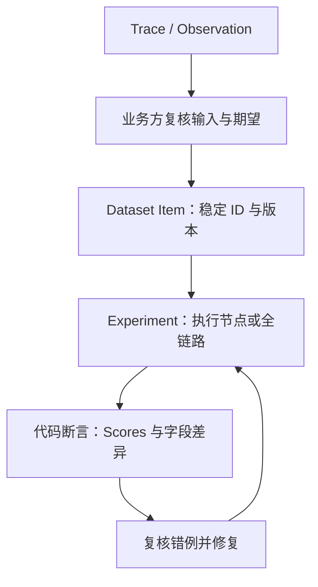

# ADR 0029 · 节点级调试接口与节点回归工作台（含私有工具 HTTP 录放）

- 状态：已采纳（节点执行能力已建成，Langfuse 回归闭环待迁移）
- 日期：2026-09-24
- 关系：在 [ADR 0024](./0024-langgraph-native-rearchitecture.md) D6 全链路评测门之下增加节点层；沿用 [ADR 0002](./0002-comprehensive-runtime-harness.md)
- 使用指南：[docs/development/nodes-run.md](../development/nodes-run.md)
- 作者：图灵科技 + Tony

## 背景

修改一个节点后要重跑整条链路；全链路依赖 LLM、后端与 GOATS，慢且受外部环境影响，失败也难以归因到节点。Langfuse 已记录每个节点的输入 / 输出（ADR 0024 D5），缺的是"把一次真实运行中某个节点的输入 / 正确输出固化为用例，以后只回归该节点"的机制。

## 决策

### D1 · 节点调试接口（`app/api/nodes.py`，注册表 `app/node_execution/registry.py`）

- `POST /v1/nodes/prepare`：把 Langfuse observation 的输入转换为该节点可执行的 State——裁剪节点不读取的字段、做显式类型转换、报告缺失的必需上下文；不执行节点。
- `POST /v1/nodes/run`：隔离执行一个已注册节点或复合子图，只收集目标节点自身的 updates（`app/node_execution/executor.py`），不从最终 State 或差值推算输出；**不执行上游、不恢复 checkpoint、不继承前一次调用的 State**；下单 / 确认 / 撤单 / 持久化等节点保留原有副作用，连接真实后端时先测只读节点。
- 注册名称以注册表为准，按产品分组（main / swap / option / option_close 等）；注册表不是展示白名单，节点数量不写死。

### D2 · 节点级 fixture 与人工标注

- 存放：`tests/fixtures/nodes/<product>/<node>.jsonl`，一行一个用例；字段级标注是默认方式（只断言稳定业务字段，如标的代码 / 价格类型 / 跟量比例，不断言耗时、trace_id）。
- 稳定字段与安全回放契约由 `harness/node_registry.py` 显式声明；自动从 Langfuse observation 发现的新节点可标注，但**默认禁止回放**；只输出动态 trace / 私有中间态 / 空对象的节点为"仅查看"，服务端拒绝保存空断言。
- 带写副作用的节点 fixture 只用于留存标注，批量回归时显示 `SKIP`，不调用节点、不计失败。

### D3 · 节点回归入口（`python -m harness node-run`）

- 本地直调（`harness/node_runner.py`）或 `--transport http`（依次调 `/v1/nodes/prepare` 与 `/v1/nodes/run`，HTTP 模式不支持 `--mock`）；两种模式与 `harness run` 复用同一 `differ` 字段级 diff 与 JSON 报告。
- `--mock` 使用 `harness/node_mocks.py` 的显式外部依赖 mock（当前试点 `swap_place_order`），不在业务代码内置任何"备用实现"开关（CLAUDE.md 禁止项）。
- 节点回归与全链路 categories 回归保持不同覆盖范围，均按确定性断言评分，不调用 LLM Judge（ADR 0005）；Langfuse Experiment 记录回归，统一放行门见 ADR 0030。

### D4 · 私有工具 HTTP 录制与严格回放（`harness/http_tape.py`）

- 录制对象限私有业务工具 HTTP（operate / GOATS 等）；匹配 method、URL、身份头与去凭据后的 body；同一请求多次出现时按派发顺序回放。
- 回放**没有网络回退**：无匹配录音抛 `TapeMissError`，不会把请求放行到真实后端；不完整或不支持的录音抛 `TapeFormatError`。
- 模型 HTTP、数据库访问、附件下载不在录放范围。

### D5 · 逐步迁移到 Langfuse 回归闭环

- Langfuse 管理 Dataset、Experiment、Score、Trace 与人工标注关联；harness 提供执行器、稳定字段契约、确定性比较和失败退出码，CLI 保留用于本地复现。
- 迁移期以已审阅的 git fixture 为基线，按稳定 case ID、套件与版本单向同步到 Dataset。平台采集的新标注先导出并经业务复核后合入 fixture，再发布为下一版数据集；不做双向自动覆盖，也不维护两套不同断言。
- 逐节点迁移：先定义可回放输入与稳定期望，再关联来源 observation、记录 Experiment 与确定性 Scores，最后用同批输入比对本地与平台的字段差异和 PASS / FAIL。迁移通过前保留既有本地回归能力。
- 写副作用的节点仍仅留存标注，自动节点回放显示 SKIP；平台接入不能绕过此限制。依赖真实 Java 的全链路业务验收继续由主代理在授权环境执行。
- 回归结果须带数据集版本、代码版本、模型标识、执行模式、断言版本与 trace 关联；失败回到人工复核和修复后重跑，不能通过修改 expected 来掩盖实现错误。

上述设计使用 Langfuse [Datasets](https://langfuse.com/docs/evaluation/experiments/datasets) 与 [Scores](https://langfuse.com/docs/evaluation/evaluation-methods/scores-via-sdk) 关联能力，不依赖 LLM Judge。项目既有 SDK / 自托管部署版本保持不变，实际接入前核对已安装版本能力；本决策不安排平台升级。

## 备选方案

- **只保留全链路回归**：慢、外部依赖多、失败不能归因到节点。否决。
- **只用 pytest + mock 单测**：无法复用真实运行中的输入 / 输出，标注不能由业务方参与。否决。
- **节点调试接口 + 标注 fixture + 节点回归 + HTTP 录放（已选）**。

## 后果

- 正面：单节点改动秒级回归；业务方可在工作台上标注正确输出；真实后端交互可录制后离线严格回放。
- 负面：节点 fixture 与代码演进之间需要漂移守护（字段改名、节点拆分时 fixture 失效）；tape 中可能残留业务敏感数据，入库前须脱敏审查；`/v1/nodes/run` 在真实后端上是带副作用的调试面，须限制暴露。
- 迁移尚未完成，执行器、数据集同步、Scores 一致性及 fixture 漂移守护的待办见[工作计划](../work-plan.md)。`/v1/nodes/*` 的生产暴露与 tape 保留策略仍须按部署边界核对。

## 关联

- [ADR 0002](./0002-comprehensive-runtime-harness.md) · 综合运行时 Harness
- [ADR 0024](./0024-langgraph-native-rearchitecture.md) D5 / D6 · Langfuse 契约与评估 gate
- [docs/development/nodes-run.md](../development/nodes-run.md) · 使用指南
- `harness/README.md` · 模块职责
