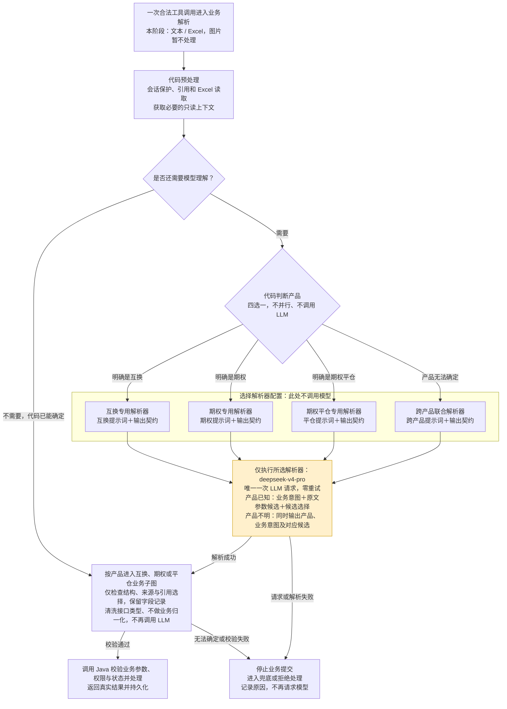

# ADR 0031 · 单次工具调用全链路最多一次模型请求

- 状态：已采纳（目标约束，代码待重构）
- 日期：2026-09-24
- 关系：修订 ADR 0001 D5、0024 D3、0027 D2；调用端重试职责与单次调用预算遵循 ADR 0026；产品划分遵循 ADR 0007，确认、提示词、标的与单动作边界继续遵循 ADR 0021、0023、0025、0028。
- 作者：图灵科技

同一条指令被产品分类、意图识别、参数提取和候选选择重复解释，增加了调用次数与语义不一致的机会。每次工具调用的完整业务处理链最多发起一次模型请求，必要的语义判断在这一次请求中完成，后续采用结构与来源检查、接口类型清洗、接口提交和 Java 业务处理。调用减少带来的准确率、成本和延迟变化须通过评测验证。

## 约束

1. **按单次工具调用计数。** 从一次合法调用进入 LangGraph 到返回或失败结束，所有主图、嵌套子图、工具封装、并行分支和循环共享一次模型请求额度；允许零次。多订单、多 Excel 文件及行不增加额度。调用端使用相同 `message_id` 再次调用时独立计数，可以重新解析；LangGraph 不保存跨调用的模型额度或幂等缓存。调用端负责总重试次数与并发调度（ADR 0026）。
2. **约束真实请求。** 可以保留多个互斥的 LLM 解析节点，但同一次工具调用最多执行其中一个且最多发起一次模型请求。禁止通过合并函数、逐订单/逐附件处理、Agent 工具循环、并行调用或新增模型代理服务规避额度。
3. **调用内全部 LLM 重试关闭。** 模型请求一经发起即占用本次调用额度；超时、限流、输出解析或证据校验失败都不得在本次调用内再次请求，不允许补问、输出修复、备用模型或提示词切换重试。错误沿现有 cascade 机制停止业务提交并返回可追踪的失败结果。SDK、图节点和本次调用的外层封装均不得重复调用模型，也不得自行重启整图获取新额度；外部调用端发起的新调用按第 1 条计数，外部网关自身行为需按其契约独立核查。
4. **本阶段处理文本与 Excel。** 适用于互换、期权、期权平仓的文本与 Excel 输入；当前模型基线为 deepseek-v4-pro，可经通用配置切换并重新验收（ADR 0020）。图片暂不处理，图片解析、OCR 与多模态接线不在本阶段实施和验收范围。约束本项目发起的模型请求；快速询价、存量查询仍走既有入口，不假设 Java / GOATS 服务内部的模型调用次数。

## 解析职责

- 先完成无需模型的会话保护、入口分流、引用读取、Excel 读取和可确定的产品路由。需要后端只读数据作为模型上下文时，先用确定性依据获取；不得先用一次模型分类，再查数据后第二次提取。
- 产品已确定时，可以进入该产品的专用联合解析；产品不明确时，唯一一次请求联合判断产品、单一业务意图并提取必要的原文候选。不得先只输出产品，再由产品子图调用模型。
- 有歧义的对手/标的候选选择与参数抽取共用本次解析结果；明确的编号或引用选择继续由代码处理。保持单业务动作、多订单共用该动作，不产生多动作编排。
- 后续图节点保留结构与来源检查、字段锁定、引用选择范围、接口提交、回复与持久化等职责。LangGraph 允许接口类型兼容清洗及有记录的字段省略，参数字符串 JSON 失败按 Dify 回退空对象；不增加业务归一化或业务数值校验（ADR 0027）；数值、权限、订单状态、证券识别、业务默认值与执行结果由 Java 校验并处理。
- PromptSpec、Pydantic 输出契约、Git 提示词真源及业务子图边界继续保留。共同输出需表达产品、意图及对应候选约束，不能只是将旧提示词拼成一个无边界的大提示词。
- LangGraph 当前不做二阶段处理；每次只识别并提交本次业务动作，由 Java 决定后续流程（ADR 0021）。用户随后发来的确认类消息是新的独立调用，不恢复本地待确认状态，也不把普通动作自动提升为确认。

## 目标流程图：全链路最多一次模型请求

产品分类回答“属于互换、期权还是期权平仓”，业务意图识别回答“要询价、下单、撤单还是确认”，参数提取回答“标的、金额、期限等具体是什么”。能够确定的判断由代码完成，需要模型理解的判断在目标流程中共用一次联合解析。

下图只展示本 ADR 要求的目标流程：代码先从互换、期权、期权平仓、跨产品四种解析器中选择一个，再执行唯一一次模型请求。解析器可以各自保留提示词和结构化输出契约，并共用配置的 STANDARD 模型（当前基线 deepseek-v4-pro，ADR 0020），不要求把所有产品合成一套大提示词。快速询价、存量查询仍走既有入口；图中名称表达职责，尚未指定重构后的函数名或文件位置。

**四种解析器每次只选一个，意图识别与参数提取在唯一的黄色节点中一次完成，全链路模型请求总数只能为零或一。** 产品已由代码确定时，将该产品作为解析约束；产品不明确时，由跨产品解析器在同一次请求中一并判断。跨产品解析完成后直接进入对应业务子图校验、执行，不再调用产品专用解析器。图中的汇合表示四条互斥路径共用一次请求额度，不表示同时执行四种解析器。

模型请求失败也已消耗额度，本次调用直接进入失败处理。产品分类之后不得再请求模型识别意图，意图识别之后不得再请求模型提取参数，候选选择、附件处理与后端查询重试也不得追加模型请求。

互换、期权、期权平仓业务子图继续保留，消费确定性判断或联合解析的结果，完成后续校验与执行，不再单独调用模型重复识别意图或提取参数。本次处理不强制要求第二阶段确认；后续用户消息属于新的工具调用，适用的动作与引用选择仍须一致。以上是目标设计，迁移状态以[工作计划](../work-plan.md)为准。

## 附件边界

- Excel 先由代码读取并保留单元格来源，在一次模型请求中批量提取；不得逐行调用。
- 图片暂不处理：不安排图片解析、OCR、多模态模型接线或图片字段准确率验收。收到图片或含图片的混合输入时，明确提示改用文本或 Excel，不静默忽略图片后继续提交，也不调用其它模型补充解析。
- 输入超出所选模型容量、输出无法完整承载订单，或部署缺少相应模型能力时，停止处理并明确提示用户调整输入；禁止静默截断、漏订单或分批追加请求。输入容量按模型能力设置，具体阈值经测试确定，不在 ADR 写死。

## 错误与验证

单次工具调用内，只读后端查询可独立有限重试，写类节点继续不自动重试。模型解析与可重试的查询必须分开，后端失败不得在本次调用内导致已执行的模型重新运行。不得全局关闭所有 IO 重试来替代正确拆分职责。

验收须同时覆盖调用额度和业务质量：检查图中的串行与并行路径，并在模型请求边界验证每次工具调用实际请求次数不超过一；覆盖歧义产品、引用、多订单、多 Excel 附件、零模型请求、失败和后端重试场景。同一消息由调用端先后调用两次时分别计数，首轮失败不能消耗后一次调用的额度；LangGraph 内部自行重试不得重置额度。业务质量继续遵守 ADR 0030 的数据集与节点级评测门，不通过扩大拒绝范围、漏字段或漏订单换取额度合规。合并节点后同步迁移 PromptSpec、Harness 注册、节点 fixture 和流程文档。

## 后果

一次联合解析降低了重复解释的机会，但扩大了该次请求的输入输出契约；必须用按产品与意图组织的契约和回归数据控制复杂度。关闭内部重试会使瞬时模型错误直接影响本次调用结果，失败率与延迟基线需重新测量，不能沿用“重试后”的可靠性假设。单次工具调用额度不限制调用端累计消耗，跨调用的重试预算由调用端管理。

期权平仓继续作为独立业务子图，意图与动作处理仍有清晰边界；独立节点不等于独立模型调用。产品路由保留既有规则优先级：订单号优先于关键词，引用卡片、附件类型及上下文作为判定依据；上下文继承不增加模型调用，仍无法确定产品或意图时进入统一 unknown 兜底。路由来源与候选证据必须可追踪。

实施待办见 [工作计划](../work-plan.md)。目标规范获采纳不等于当前代码已经满足；上线前仍须完成 ADR 0030 的评测与观察。
