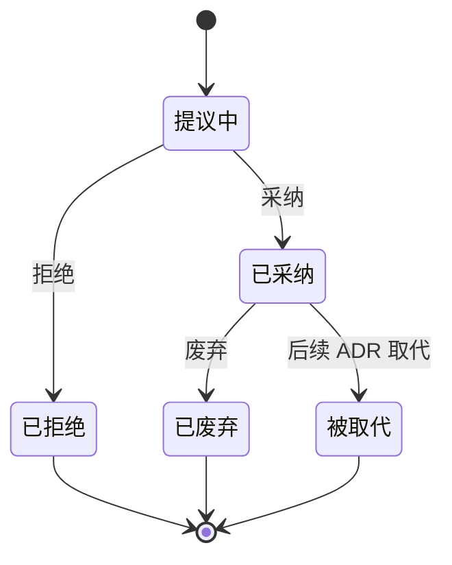

# 架构决策记录（ADR）

本目录记录场外衍生品 AI 指令助手（otc-agent）的架构决策及其演进。ADR 编号发布后永久固定；被拒绝、废弃或被取代的记录予以保留，编号不复用。

**项目目标**（[ADR 0030](./0030-goal-restatement-native-langgraph-dataset-eval-harness.md)）：以原生 LangGraph 重构场外衍生品 AI 指令链路，以数据集开展评测，并按 Harness 工程规范管理变更。

## 按目标主线阅读

**一、原生 LangGraph 重构**

- [0000](./0000-migrate-from-dify-to-langgraph.md) 迁移动机 → [0001](./0001-rewrite-app-with-harness-first.md) 重写方式 → [0024](./0024-langgraph-native-rearchitecture.md) 目标架构（后续实质变更新建 ADR）
- 业务结构：[0031](./0031-single-model-request-per-message.md) 单次工具调用最多一次模型请求 · [0028](./0028-session-entry-and-multi-instruction-send-orchestration.md) 入口分流与单动作多订单
- 交易正确性：[0021](./0021-text-confirm-replaces-interrupt.md) 单次指令处理边界 · [0026](./0026-request-idempotency-uncertain-receipts-reconciliation.md) 调用端幂等职责与单次调用回执 · [0027](./0027-field-evidence-contract.md) 字段证据契约
- 职责边界：[0025](./0025-instrument-resolution-delegated-to-backend.md) 标的识别由 Java 调用工作流完成
- 基础设施：[0009](./0009-mysql-version-and-tdsql-compatibility.md) MySQL / TDSQL

**二、数据集评测与评估**

- [0002](./0002-comprehensive-runtime-harness.md) 综合运行时 Harness · [0029](./0029-node-level-debug-api-and-regression-workbench.md) 节点级回归工作台 · [0030](./0030-goal-restatement-native-langgraph-dataset-eval-harness.md) D3 统一评测门
- [0005](./0005-annotation-roles-judge-plus-business-spotcheck.md) 确定性断言 + 业务方复核 · [0014](./0014-langfuse-as-harness-backend.md) LangFuse 后台 · [0004](./0004-trace-granularity-node-level.md) trace 颗粒度

**三、Harness 工程纪律**

- [0023](./0023-prompt-as-code-langgraph.md) 提示词即代码 · [0003](./0003-prompt-versioning-by-git-branch.md) 提示词版本化 · [0020](./0020-unify-all-llm-on-deepseek-v4-pro.md) 通用模型配置与当前基线 · [0019](./0019-incident-severity-thresholds.md) 故障升级阈值

## 总表

| 编号 | 标题 | 状态 | 关系 |
|---|---|---|---|
| [0000](./0000-migrate-from-dify-to-langgraph.md) | 从 Dify 工作流迁移到 LangGraph | 已采纳 | 现状见 0024 |
| [0001](./0001-rewrite-app-with-harness-first.md) | 推倒重写 `app/`，Harness-first | 已采纳 | 标的职责见 0025；评测门见 0030 |
| [0002](./0002-comprehensive-runtime-harness.md) | 综合运行时 Harness 三位一体 | 已采纳 | 节点层由 0029 补充 |
| [0003](./0003-prompt-versioning-by-git-branch.md) | 提示词版本化：git 分支 + 单文件 | 已采纳 | — |
| [0004](./0004-trace-granularity-node-level.md) | Trace 颗粒度：节点级入库 + LangFuse 完整 I/O | 已采纳 | 后台见 0014 |
| [0005](./0005-annotation-roles-judge-plus-business-spotcheck.md) | 标注闭环：确定性断言 + 业务方复核 | 已采纳 | 平台由 0014 确定 |
| [0006](./0006-hitl-interrupt-boundary.md) | Human-in-the-Loop 边界：写操作 + 资金风险才需二次确认 | 已废弃 | 部分由 0021 取代 |
| [0007](./0007-subgraph-vs-intent-scope-rule.md) | 新业务场景的归属：独立子图 vs 现有子图新意图 | 已废弃 | — |
| [0008](./0008-ticker-resolution-as-react-agent.md) | 标的识别采用 ReAct Agent | 被取代 | 由 0025 取代 |
| [0009](./0009-mysql-version-and-tdsql-compatibility.md) | MySQL 协议 + TDSQL 生产环境 | 已采纳 | — |
| [0010](./0010-llm-model-selection-rules.md) | Qwen 三型号分工 | 被取代 | 由 0020 取代 |
| [0011](./0011-split-option-intent-and-extraction.md) | 期权子图拆分意图识别与分意图参数提取 | 已废弃 | 输出契约由 0027 收敛 |
| [0012](./0012-restore-backend-http-for-securities-instrument.md) | 标的查询走后端 HTTP API，弃用数据库直连 | 已采纳 | 由 0025 推广 |
| [0013](./0013-load-dynamic-inference-prompt-fragment.md) | 加载后端动态 prompt 片段 | 已废弃 | 机制移除；标的识别见 0025 |
| [0014](./0014-langfuse-as-harness-backend.md) | LangFuse 作为 Harness 后台 | 已采纳 | 修订 0004 / 0005 |
| [0015](./0015-intent-route-rules-first-llm-fallback.md) | 一级路由：规则前置 + LLM 兜底 | 已废弃 | 入口层由 0028 前置 |
| [0016](./0016-m3-scope-engineering-loop-not-shadow.md) | 迁移验收改为工程联调闭环，而非 Shadow 双跑 | 被取代 | 由 0030 取代 |
| [0017](./0017-m4-canary-quantitative-exit-gate.md) | 金丝雀切流退出门量化指标 | 被取代 | 指标并入 0030 |
| [0018](./0018-dev-qwen-prod-deepseek-llm-split.md) | 开发期 Qwen / 客户现场 DeepSeek 双模型分立 | 被取代 | 由 0020 取代 |
| [0019](./0019-incident-severity-thresholds.md) | 故障升级阈值 P0 / P1 / P2 | 已采纳 | 与 0030 D3 互补 |
| [0020](./0020-unify-all-llm-on-deepseek-v4-pro.md) | 通用模型配置与 DeepSeek Pro 当前基线 | 已采纳 | — |
| [0021](./0021-text-confirm-replaces-interrupt.md) | 单次指令处理：LangGraph 识别提交，Java 决定流程 | 已采纳 | 本次动作与引用选择见 0027 D5；会话持久化独立保留 |
| [0022](./0022-prompt-governance-after-code-migration.md) | 代码迁移完成后的提示词治理模型 | 已废弃 | 契约治理由 0023 承担 |
| [0023](./0023-prompt-as-code-langgraph.md) | 提示词即代码：PromptSpec | 已采纳 | 输出契约由 0027 收敛 |
| [0024](./0024-langgraph-native-rearchitecture.md) | LangGraph 原生重构目标架构 | 已采纳 | 拆出 0025-0029；D3 由 0031 修订，D4 幂等职责由 0026 修订 |
| [0025](./0025-instrument-resolution-delegated-to-backend.md) | 标的识别职责边界：Java 调用识别工作流 | 已采纳 | 追认已有实现；修订 0001 D4 / 0023 / 0024 |
| [0026](./0026-request-idempotency-uncertain-receipts-reconciliation.md) | 调用端幂等职责与单次调用回执契约 | 已采纳 | 修订 0024 D4；模型额度见 0031 |
| [0027](./0027-field-evidence-contract.md) | 字段来源契约 | 已采纳 | 修订 0023 D2；模型重试见 0031 |
| [0028](./0028-session-entry-and-multi-instruction-send-orchestration.md) | 会话保护入口分流与单动作多订单 | 已采纳 | 解析约束见 0031 |
| [0029](./0029-node-level-debug-api-and-regression-workbench.md) | 节点级调试接口与 Langfuse 回归闭环 | 已采纳 | 细化 0024 D6 |
| [0030](./0030-goal-restatement-native-langgraph-dataset-eval-harness.md) | 目标重述与统一评测门 | 已采纳 | 修订 0001 / 0002 / 0005 / 0019 / 0024 D8 |
| [0031](./0031-single-model-request-per-message.md) | 单次工具调用全链路最多一次模型请求 | 已采纳 | 修订 0001 D5 / 0024 D3 / 0027 D2；调用职责见 0026 |

总表汇总各 ADR 的编号、标题、状态及关系。状态表示决策效力，不表示实现完成；现状与待办统一见 [工作计划](../work-plan.md)。历史状态或替代范围存在冲突时，由维护者裁定。

## 编写规范：轻量模板

本项目采用 [Michael Nygard 的 ADR 格式](https://cognitect.com/blog/2011/11/15/documenting-architecture-decisions)，包含标题、状态、背景、决策和后果；备选方案及相关链接按需记录。以下为项目模板。需要记录详细权衡时，可参考 [MADR](https://adr.github.io/madr/)。

新建 ADR 按模板使用固定的二级章节名称及顺序。备选方案和相关链接为可选章节；章节内可设三级标题。提交前删除模板说明文字并补充决策内容。

```markdown
# ADR NNNN · 简短决策标题

## 状态

- 状态：提议中
- 日期：YYYY-MM-DD
- 作者：记录编写者（可选）
- 替代：无，或前序 ADR 编号、链接及替代范围
- 被替代：无，或后续 ADR 编号、链接及被替代范围

## 背景

描述决策时的问题、约束和关键前提；必要时列出决策驱动因素。

## 决策

明确选择的方案、理由、适用范围及架构约束。

## 后果

如实记录预期收益、代价、风险和取舍；不只写优点，也不编造负面结果。

## 备选方案

可选：评估过的主要选项及未选择它们的理由。

## 相关链接

可选：相关 ADR、评审记录、实现证据和参考资料。
```

- 每篇 ADR 记录一项架构决策；同一决策的必要子条款归入该记录。
- ADR 应在决策形成时记录，并保持简洁。追认记录须注明实际决策日期、记录日期及依据，不得补造审批信息或实现状态。
- “后果”记录决策产生的预期影响；实现进度与验收状态统一维护于工作计划。
- 相关链接用于标识必要的评审及实现依据。任务进度不作为 ADR 内容；度量数据须注明时间、口径与来源。
- ADR 不记录凭据、内网地址或敏感配置。代码、图表及引用遵循所属章节的编辑权限。

## 生命周期与历史保留

| 状态 | 含义 |
|---|---|
| 提议中（Proposed） | 正在讨论，尚未批准，不作为已生效的架构依据 |
| 已采纳（Accepted） | 已获批准，在适用范围内有效；不代表实现或验收已完成 |
| 已拒绝（Rejected） | 提案未被接受，保留内容及拒绝理由 |
| 已废弃（Deprecated） | 曾接受的决策不再适用或推荐，不一定有替代方案 |
| 被取代（Superseded） | 曾接受的决策被后续 ADR 取代，须注明替代编号与范围 |



已采纳 ADR 不得退回提议中。实质性重议须新建 ADR，并在新旧记录中注明取代关系。
- 部分取代须标明受影响条款及仍有效范围；新旧 ADR 应建立双向链接。
- 追认表示决策形成方式，不构成独立状态。“已冻结”不属于生命周期状态；既有冻结标记保留为历史约束，AI 不得自行移除。
- 旧状态“已撤销”归为“已废弃”，“已被某 ADR 取代”归为“被取代”。状态或替代范围不明时，由维护者裁定。
- 文件采用四位编号及小写 kebab-case 标题。新编号取下一个未使用、未预留的编号；编号不回收。已发布 ADR 的编号、文件名保持稳定，已拒绝、废弃或被取代的记录永久保留。
- 决策实质变化通过新 ADR 记录。旧 ADR 的背景、决策、权衡及后果保持不变，仅更新状态与关系元数据。拼写、格式及链接修订不得改变历史语义。

## AI 编辑权限

- 只读章节的拼写、格式、链接及澄清修订须取得用户针对该次修改的明确授权。AI 不得补写未经证实的历史背景或后果；决策语义变化须另建 ADR。
- 审核不构成正文修改授权。AI 不得为满足检查要求而降低决策约束、删除历史内容、变更章节结构或调整状态以规避只读限制。
- 状态或权限不明确时，正文保持只读，并提交维护者裁定。
- 人类维护者负责决策批准与历史纠错；纠错不得将后续决策表述为原始结论。

## 既有 ADR 的适用方式

新模板适用于新建 ADR。既有 ADR 保留原有结构，不批量重排其已采纳正文。既有头部中的“状态 / 日期 / 关系 / 作者”为元数据；“关联”为相关链接。正文内容默认只读，章节名称不影响其保护范围。

历史存根予以保留，不补造决策背景。历史代码路径失效不构成恢复旧实现的依据。既有决策或公共规则与本规范不一致时，记录差异，由维护者通过新 ADR 及相应关系或规则更新完成衔接。

## 人工复核

ADR、文档布局及告警阈值采用人工审核。维护者复核 ADR 编号、章节结构、引用、状态及双向关系；阈值变更须核对实现、ADR 与 runbook。结构完整不代表决策合理或实现合规。
