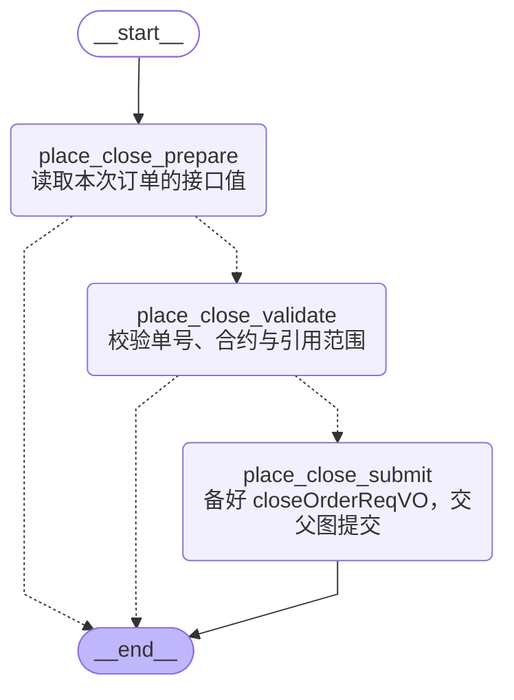

# 平仓下单内部图流程

代码真源：[app/subgraphs/close/place_close.py](../../app/subgraphs/close/place_close.py)。图按当前编译拓扑核对；产品子图内部流程单独成文。

`place_close_prepare` 读取本次订单；`place_close_validate` 校验单号、合约和引用选择一致性；`place_close_submit` 准备 closeOrderReqVO，交平仓父图清洗后提交。不会在图内重新查询后再调用模型，也不换算金额、补执行参数或校验数字范围。

返回[主图](./main-graph-flow.md)。

写入 `state.error` 的错误停止后续业务提交；参数字符串 JSON 容错按 ADR 0027 D3 处理。错误信息、节点与真实回执留在审计输出。LLM 请求预算适用于整次调用，不因进入子图重置。

`place_close_submit` 是保留名称的请求准备节点，输出 `pending_backend_request`；Java 调用统一位于平仓父图的清洗和提交节点，内部图不发起 HTTP。
