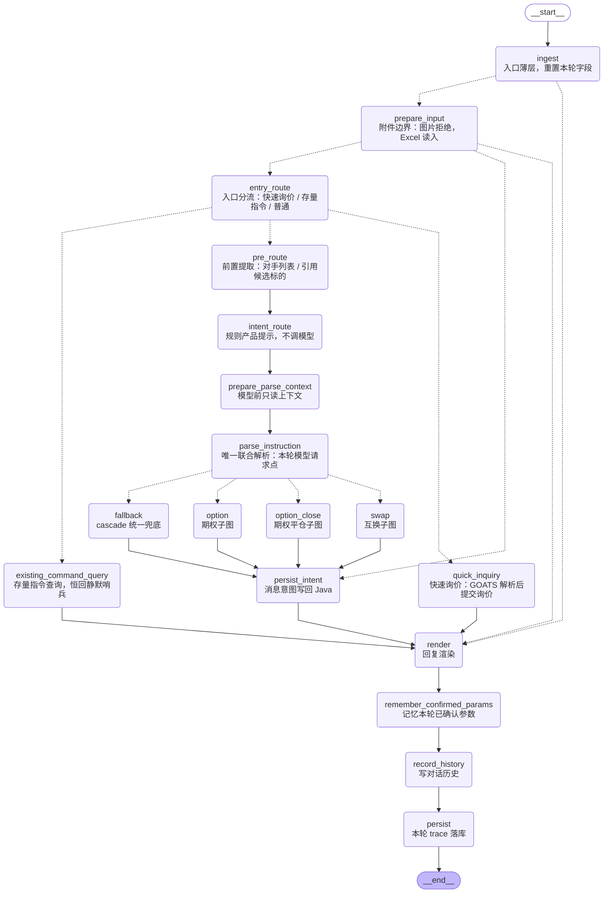

# 主图流程

代码真源：[app/graph/main.py](../../app/graph/main.py)。图按当前编译拓扑核对；产品子图内部流程单独成文。

一次合法 HTTP 调用拥有独立模型额度；规则选择期权、互换、平仓或跨产品 PromptSpec，只有 `parse_instruction` 请求模型。`prepare_parse_context` 的后端只读重试发生在模型之前；模型失败不重试，直接 cascade。图片与含图片输入在入口拒绝；Excel 全量读入后一次解析。快速询价与存量分支沿既有外部工具执行。`entry_route` 输出 `entry_branch`；快速入口由 `fast_query="1"` 明确选择，并确定性给出 `option/new_inquiry`，与 `at_bot` 独立，不调用普通联合解析器。

## 独立流程文档

- [期权子图](./option-graph-flow.md)
- [互换子图](./swap-graph-flow.md)
- [期权平仓子图](./close-graph-flow.md)
- [普通期权询价内部图](./option-inquiry-flow.md)
- [互换下单准备内部图](./swap-place-flow.md)
- [平仓下单内部图](./close-place-flow.md)
- [节点调试执行图](./node-execution-flow.md)

写入 `state.error` 的错误停止后续业务提交；参数字符串 JSON 容错按 ADR 0027 D3 处理。错误信息、节点与真实回执留在审计输出。LLM 请求预算适用于整次调用，不因进入子图重置。
