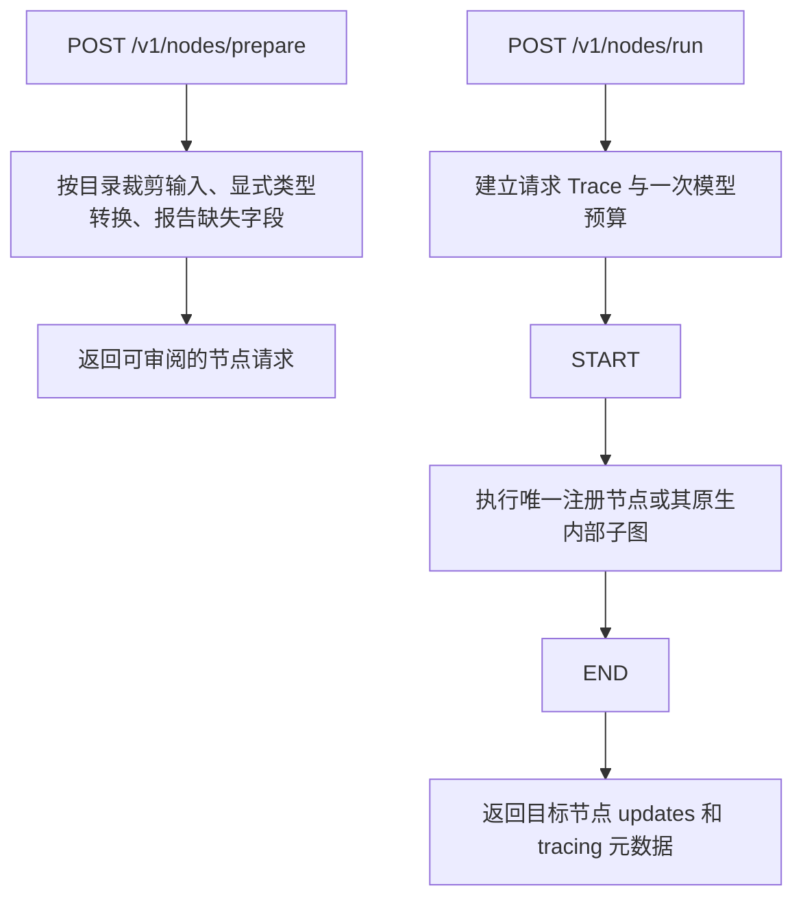

# 节点调试执行图

代码真源：[NodeExecutor](../../app/node_execution/executor.py)、[节点目录](../../app/node_execution/catalog.py)。主图及业务子图见[主图索引](./main-graph-flow.md)。

`prepare` 不执行节点。`run` 不调用上游，不恢复 checkpoint，也不继承上次状态。直接调试交易节点仍有写副作用；批量节点 Experiment 以本仓目录为安全边界，写节点仅留存标注并显示 SKIP。

模型预算覆盖目标节点及内部子图；只读后端节点保留独立有限重试。模型、结构化解析和证据失败不重试。HTTP 评测的父 trace 仅在 `TRUST_INBOUND_TRACEPARENT=true` 时接入；受信任部署入口必须限制该头来源。

## 参数准备、清洗与提交的节点边界

普通动作的旧 extract/confirm/cancel/query 叶节点现在只准备 `pending_backend_request`。独立调试业务请求时，按“参数准备 → 产品 clean_request → 产品 submit/query_backend”依次调用，或直接运行整个产品子图。参数与清洗节点可安全回放；三个 submit 节点仍标为 write，不允许 Dataset 自动回放。

清洗输入保留 `field_records`，避免 /prepare 丢弃锁定身份；输出保留十进制数字字符串，节点 HTTP 往返不经过 float 运算。提交入口复核清洗结果与原请求、字段锁一致，不能伪造已清洗请求绕过过滤。
