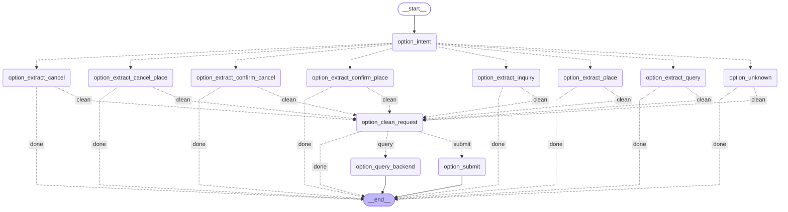

# 期权子图流程

代码真源：[app/subgraphs/option/graph.py](../../app/subgraphs/option/graph.py)。图按当前编译拓扑核对；产品子图内部流程单独成文。

`option_intent` 校验并读取主图联合结果，不调用模型。每轮只路由一个意图，可携带多笔订单。询价、补参、确认、撤单都使用 Java 现有 type；只读状态查询单独有限重试。确认只提交本次单号及显式增量，不重建引用卡片。

## 独立流程文档

- [普通询价内部图](./option-inquiry-flow.md)

返回[主图](./main-graph-flow.md)。

写入 `state.error` 的错误停止后续业务提交；参数字符串 JSON 容错按 ADR 0027 D3 处理。错误信息、节点与真实回执留在审计输出。LLM 请求预算适用于整次调用，不因进入子图重置。

## Java 请求清洗与提交

所有动作节点完成本次参数、身份与选择准备后，统一进入 `option_clean_request`。原解析和字段账本保留，清洗生成独立请求副本；不兼容字段省略，0/false 保留，不补业务默认值。规则与 Dify 参数字符串 JSON 回退见 [ADR 0027](../adr/0027-field-evidence-contract.md)。

清洗成功后，写类及 JSON 回退请求进入 `option_submit`，仅独立只读请求进入可有限重试的 `option_query_backend`。参数准备和清洗节点不访问 Java、不调用模型。`backend_request` 记录实际 DTO 请求，`cleaning_records` 记录省略/转换，API 与 Harness 参数信封读取 `submitted_params` 投影。清洗后不会从原字段锁账本重新补回脏值。
