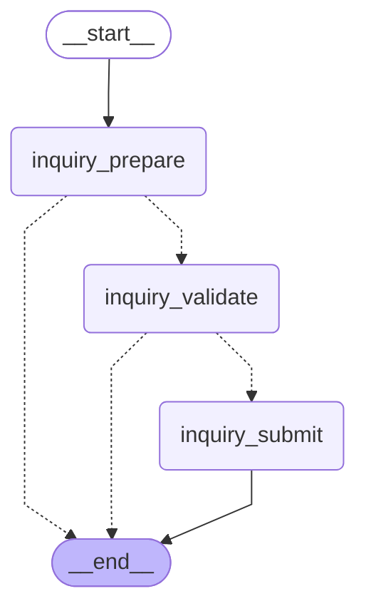

# 普通期权询价内部图流程

代码真源：[app/subgraphs/option/extract_inquiry.py](../../app/subgraphs/option/extract_inquiry.py)。图按当前编译拓扑核对；产品子图内部流程单独成文。

`inquiry_prepare` 读取本次 orders；`inquiry_validate` 检查结构与来源；`inquiry_submit` 准备完整 orderList 请求，交期权父图清洗后提交 Java。本图零模型请求，不调用 GOATS RFQ parser；外部 RFQ parser 仅属于主图快速询价入口。

返回[主图](./main-graph-flow.md)。

写入 `state.error` 的错误停止后续业务提交；参数字符串 JSON 容错按 ADR 0027 D3 处理。错误信息、节点与真实回执留在审计输出。LLM 请求预算适用于整次调用，不因进入子图重置。

`inquiry_submit` 是保留名称的请求准备节点，输出 `pending_backend_request`；Java 调用统一位于期权父图的清洗和提交节点，内部图不发起 HTTP。
