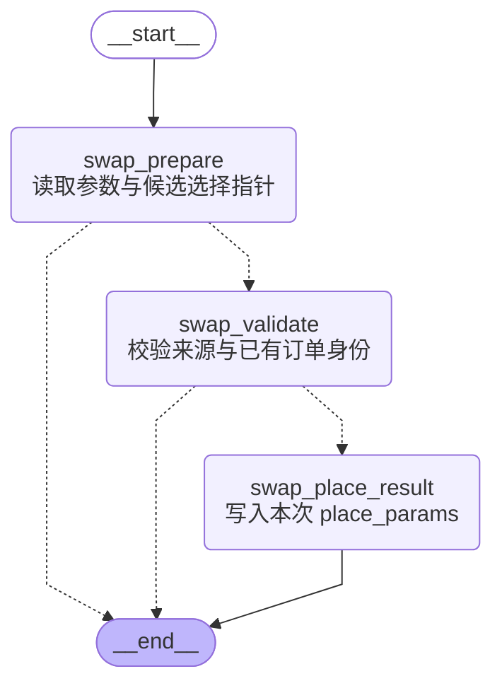

# 互换下单准备内部图流程

代码真源：[app/subgraphs/swap/place_order.py](../../app/subgraphs/swap/place_order.py)。图按当前编译拓扑核对；产品子图内部流程单独成文。

`swap_prepare` 读取订单与选择指针；`swap_validate` 校验来源和订单范围；`swap_place_result` 写入本次 place_params。这个内部图无业务写入、无模型；外层互换子图检查选择、准备原始请求并清洗后调用 Java。

选择节点保留本图写入的原始字段锁作为候选证据；经过校验的派生选择值是对应字段的有效锁。引用顺序用于“第N笔”，本次提交数组下标只用于定位已选定订单，不替代引用顺序。

返回[主图](./main-graph-flow.md)。

写入 `state.error` 的错误停止后续业务提交；参数字符串 JSON 容错按 ADR 0027 D3 处理。错误信息、节点与真实回执留在审计输出。LLM 请求预算适用于整次调用，不因进入子图重置。
