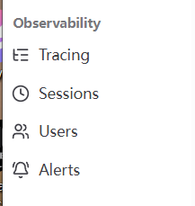
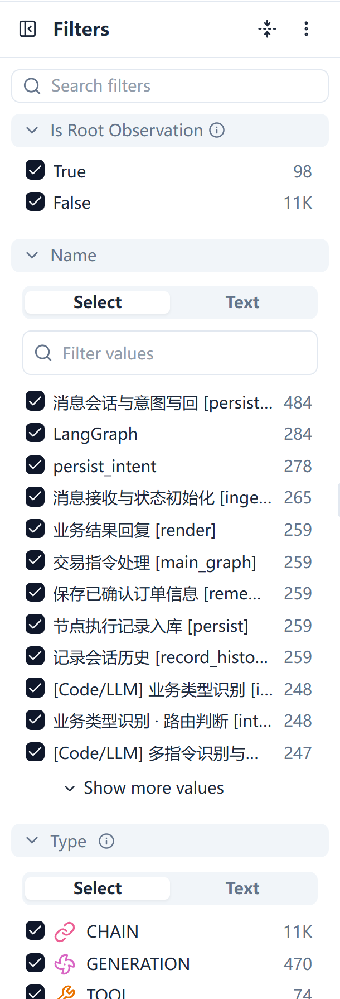

# A2 · Session、User、Tag 与过滤

| 页面属性 | 内容 |
|---|---|
| 负责人 | @HXl |
| 状态 | 草稿 |
| 适用 Langfuse 版本 | Python SDK v4（本机 4.15.0）；自托管 4.46.0（沿用同日资料审阅记录的版本核对结果） |
| 最后验证日期 | 2026-09-29（代码、官方文档、既有截图与 CLI 参数核对；沙箱操作尚未逐项验证） |
| 验证人 |  |

## 1. 适用人群与使用场景

开发、测试和业务同事需要查看一段多轮对话、查某位业务用户的记录，或反复使用同一组筛选条件时，按本手册操作。

## 2. 前置条件

**账号权限**：能登录指定的沙箱项目，能查看 `Tracing`、`Sessions`、`Users`；保存视图还需要该项目允许创建视图。没有该权限时，可以先用浏览器书签保存筛选链接。

| 使用方式 | 环境变量名称与准备方式 |
|---|---|
| 只用网页 | 本机不用设置变量；从管理员处取得 `LANGFUSE_BASE_URL` 对应的入口 |
| 步骤 7 的可选命令 | 管理员预先配置沙箱的 `LANGFUSE_BASE_URL`、`LANGFUSE_PUBLIC_KEY`、`LANGFUSE_SECRET_KEY`；兼容旧 CLI 时使用 `LANGFUSE_HOST` |
| 命令的本地查询参数 | `LANGFUSE_CLI_PATH` 指向已经安装的 CLI 的 `bin/langfuse.mjs`；`LF_SESSION_ID` 是这次要查的测试会话 ID |
| 数据找不到时交开发核对 | 应用的 `ENABLE_LANGFUSE`、`ENVIRONMENT`；评测父子链路还涉及 `TRUST_INBOUND_TRACEPARENT` |

## 3. 操作步骤

### 步骤 1：认清要找的对象，进入沙箱

1. 打开管理员提供的入口，核对左上角组织和项目。
2. 先按下表选入口，再设定覆盖测试发生时间的时间范围，留意页面显示的时区。

| 对象 | 用直白的话解释 | 什么时候用 |
|---|---|---|
| Session（会话） | 把同一段交互的记录放进一个“文件夹”，靠 Session ID 归在一起 | 看前后几轮发生了什么 |
| User（业务用户） | 业务应用上报的用户编号 | 查同一个人的多次交互；不是管理 Langfuse 登录账号 |
| Tracing（调用链） | 一组有父子关系的执行步骤 | 看某次执行经过了哪些节点 |

例如，同一个测试用户上午、下午分别开始对话，可以有两个 Session；每个 Session 内又有多次请求。标签可以横跨用户和会话。Session 不要求只有一个用户，群聊中要逐轮核对实际 User ID。



图 1：仓库既有的导航截图。概念的完整说明见官方 [Sessions](https://langfuse.com/docs/observability/features/sessions)、[User Tracking](https://langfuse.com/docs/observability/features/users) 和 [Tags](https://langfuse.com/docs/observability/features/tags)。

### 步骤 2：找到一段会话，按顺序读完各轮

1. 左侧点击 `Sessions`，页面右上角调整时间范围。
2. 在 `Filters` 中找 `Session ID`，按完整 ID 做精确匹配；
3. 点击列表中匹配的会话 ID，进入详情。若该页不好定位，转到 `Tracing`，用同一个 `Session ID` 条件查询。
4. 按发生时间从早到晚读记录。逐轮核对“用户说了什么、系统回了什么”，再进入有疑问那一轮的 Trace。
5. 若这是一条评测用例，多个 HTTP 轮次可能共用同一条 Trace。展开 `regression_case` 下的 `workflow_http`，查看 Metadata 中的 `turn`，再进入该轮服务端图。具体读树方法见 [A1 的步骤 3–4](./a1-trace-troubleshooting.md#步骤-3读懂-span-树选中正确的一轮)。

**本项目优先用接口实际返回的 Session ID。** 主接口在 `data.outputs.session_id` 返回它，节点接口在 `tracing.session_id` 返回它。一般与 `conversation_id` 一致；含中文或过长的会话 ID 会映射成观测用 ID。直接复制返回值，不自行截短或改名。实现依据是 [tracing.py 的 `session_identifier`](../../../app/observability/tracing.py)。

阅读时可在自己的排查记录中填这张表：

| 轮次 | 时间与消息 ID | 本轮输入摘要 | 本轮回复摘要 | Trace ID / Observation ID | 需要继续核对的地方 |
|---|---|---|---|---|---|
| 第 1 轮 | 按实际记录填写 | 用户最初提出什么 | 系统如何回答 | 按实际记录填写 | 哪些信息应与下一轮有关 |
| 第 2 轮 | 按实际记录填写 | 用户补充或纠正什么 | 回复是否对应本轮 | 按实际记录填写 | 打开解析节点，核对收到的上下文 |

**出现在同一个 Session，只说明记录被归在一起，不证明模型收到了上一轮内容。** 怀疑上下文丢失时，打开该轮解析节点的 Input 核对历史和引用；也不要把 `Tracing` 的行数或 Session 的 Trace 数直接当成对话轮数。当前调用与跨轮边界以 [ADR 0024](../../adr/0024-langgraph-native-rearchitecture.md) 和 [ADR 0031](../../adr/0031-single-model-request-per-message.md) 为准。

### 步骤 3：按业务用户查记录，再缩小到一个会话

1. 左侧点击 `Users`，设置同一时间范围。
2. 搜索负责人给出的完整业务 User ID，点击匹配行的 `User ID` 进入详情。
3. 查看该用户关联的记录和使用统计，找到测试发生的那段时间，再打开对应 Trace 或 Session。
4. 若 Users 页搜索结果不明确，回到 `Tracing`，在 `Filters` 中用 `User ID` 精确匹配；需要只看一段对话时，再加 `Session ID` 条件。
5. 打开一条记录核对 User ID 和时间，确认没有查到名字相似的另一位用户。

本项目主接口上报的是当前业务输入解析出的 `user_id`，不是 Langfuse 登录邮箱，也不要直接拿请求顶层的 `user` 猜测。开发核对入口见 [routes.py 的 `_build_run_config`](../../../app/api/routes.py) 和 [turn_state.py](../../../app/api/turn_state.py)。

Users 页的事件数可能包含内部步骤，不等于用户发了多少条消息。没有 User ID 的节点调试记录也可能存在，不要仅凭 Users 页没有命中就认定请求没执行。

### 步骤 4：按标签筛选，分清 Tag 和 Environment

1. 回到 `Tracing`，先清除刚才的 User ID / Session ID 条件，以免仍被限定在一个人或一段对话中。
2. 打开 `Filters`，在 `Search filters` 输入 `Trace Tags`，展开对应分组。
3. 在 `Select` 中选择实际存在的标签。值多时用分组里的 `Filter values` 查找；已知完整值时也可切 `Text`。
4. 打开一条命中记录，核对它确实带有该标签。结果为空时，先去掉其他条件，再确认标签是否真的被上报。

| 容易混淆的字段 | 在本项目怎么用 |
|---|---|
| `Environment` | 记录来自哪个运行环境；应用初始化 Langfuse 客户端时使用 `ENVIRONMENT` |
| `Trace Tags` | 分类标签；当前主接口默认上报一个环境名标签，具体看 `_build_run_config` |
| `Metadata` | 额外说明，例如评测记录上的 `run_name`；不是所有节点都有同一组键 |

环境名可能同时出现在 Environment 和 Tag 中，但它们是两个独立条件。评测包装层、主接口和节点接口的上报路径不同，不保证每条记录都带主接口的标签。**不要默认存在 `option`、`swap` 或 `close` 产品标签**，也不要为了练习修改埋点或补写历史标签。依据见 [routes.py](../../../app/api/routes.py)、[nodes.py](../../../app/api/nodes.py) 与 [harness/langfuse_client.py](../../../harness/langfuse_client.py)。

v4 的标签在记录创建时写入，不能事后在 UI 中补改，见官方 [Tags 说明](https://langfuse.com/docs/observability/features/tags#tags-cannot-be-changed-later)。

### 步骤 5：组合常用条件，避免把目标记录筛掉

1. 在 `Tracing` 设置时间范围，先保留最少条件，确认能看到测试记录。
2. 在左侧 `Search filters` 找字段，用 `Select` 选已有值，或用 `Text` 输入完整 ID。
3. 每增加一个条件就看一次结果。空列表时，先撤掉最后一个条件。
4. 查内部节点或错误时，**清除 `Is Root Observation` 限制**，让根和子步骤都能出现；不是改成只选 `False`。只找入口时才限制为 `True`。



图 2：仓库既有的筛选控件截图。

下面的组合都先限定在沙箱及测试时间范围；字段名称以当前页面为准：

| 想做什么 | 条件组合 | 做完检查什么 |
|---|---|---|
| 看一段对话的全部步骤 | Session ID；清除根节点限制 | 是否覆盖已知各轮，而非只剩入口 |
| 查某位用户的一段对话 | User ID + Session ID | 两个 ID 是否同时匹配 |
| 找错误 | Status / Level = ERROR；清除根节点限制 | 打开错误步骤，核对原因；没有 ERROR 不等于业务正确 |
| 找模型报错 | Type = GENERATION + Status / Level = ERROR；清除根节点限制 | 是否真的命中模型步骤；空结果也可能表示没有模型报错 |
| 找超过 2 秒的步骤 | Latency (s) > 2；清除根节点限制 | 这是步骤耗时；父子步骤时间不能直接相加 |
| 查某次评测的用例记录 | Metadata 的 `run_name` = 完整运行名；清除根节点限制 | 键是否在该记录上；不要把所有环境只锁定为应用环境 |

**顶部 Search 与左侧 Search filters 用途不同**：前者输入查询条件，后者只帮你在面板中找到字段。以下是粘贴到顶部 Search 的查询语句，不是在终端执行的命令。示例 ID 需换成真实的 ID。

```text
session:=a2-demo-session-001
user:=a2-demo-user-001
level:ERROR type:GENERATION
latency:>2
```

多个条件用空格连接，表示同时满足；`:=` 用于文本精确匹配。查两种错误级别可用 `level:(ERROR OR WARNING)`。顶部搜索与侧栏会同步条件，输入后检查面板，避免无意中保留了旧筛选。完整语法见官方 [Filter search bar](https://langfuse.com/docs/observability/features/filter-search-bar)。

### 步骤 6：保存常用视图，下次直接打开

1. 先按步骤 5 配好一组条件，例如“测试环境中的模型错误”，确认列表结果符合条件。
2. 在 `Columns` 选择需要看的列，例如时间、名称、类型、Session ID、User ID、耗时；按需要调整排序。
3. 在顶部搜索栏下方找到 `My Views`。打开保存视图入口，选择保存当前视图的操作，命名后提交保存。
4. 暂时改一个筛选条件，再从 `My Views` 选回刚保存的视图，检查条件是否恢复。
5. 刷新页面或重新打开该视图，再检查项目、时间范围、过滤条件、列和排序。若时间未随视图恢复，手动重选；
6. 在内部排查记录中保留该视图链接和发生时间。

本次已从仓库截图核对到 `My Views` 与 `Columns` 入口，尚未实机核对保存弹窗的按钮文字和保存范围；保存能力和查询链接见官方 [Share and save queries](https://langfuse.com/docs/observability/features/filter-search-bar#share-and-save-queries)。

## 4. 验证：做完后应该看到什么

以下是操作验收清单：

- [ ] 能用完整 Session ID 找到特定的会话，按时间说明至少两轮的输入和回复。
- [ ] 能指出每轮对应的 Trace / Observation；评测共用 Trace 时，能在树中找到各轮 `workflow_http`。
- [ ] 能用同一个测试 User ID 找到相关记录；再加 Session ID 后，范围缩小到目标会话。
- [ ] 选一个实际已有的 Tag，打开命中记录确认标签；不会把没有上报的产品标签当成必选项。
- [ ] 能清除根节点限制，看到内部步骤；能解释为什么列表行数不等于消息数。
- [ ] 保存练习视图后，改变筛选再切回来，条件恢复；重新打开时检查时间、列和排序。
- [ ] 若执行了命令，API 与页面按相同条件能定位到同一条 Observation；未执行则记“不适用”。

## 5. 常见问题

| 问题 | 怎么处理 |
|---|---|
| 明明执行过，列表却是空的 | 依次核对项目、时间及时区，再清除 User、Tag、Environment 和根节点限制；每次只加回一个条件。不要重发交易试探 |
| 用 `conversation_id` 找不到 Session | 用实际返回的 `session_id`；含中文或超长的 ID 可能经过映射，见步骤 2 |
| 同一段对话被拆成多个 Session | 核对每轮返回的 Session ID。把时间和相关 ID 交开发检查调用端传参，不在 UI 中手工合并或改历史记录 |
| 同一个 Session 里有几位用户 | 群聊可能如此；逐轮核对 User ID。也要请开发排查是否错误复用了会话 ID |
| Users 中没有某条节点调试记录 | 节点入口与主接口上报字段不同；改用 Session ID 或 Trace ID 查询，不假定每条记录都有 User ID |
| Tag 列表没有“期权”或“互换” | 当前主接口默认上报环境标签；先查实际已有值。需要新增分类时交开发审阅，不手工补历史标签 |
| 选 `staging` 后实验记录消失了 | 实验包装层可能使用 `sdk-experiment`，与服务端环境不同；先放开 Environment，再按会话或实验定位 |
| 有两轮对话，却只有一个 Trace | 评测可以把多轮挂在一个父 Trace 下；按 `workflow_http` 的 `turn` 看轮次 |
| 同一消息出现了多条记录 | 可能是内部步骤，也可能是调用端重投；结合消息 ID、时间、Trace ID 和 Observation ID 区分，不直接删“重复”记录 |
| `status:ERROR` 为什么没有找到报错 | 顶部搜索的 `status` 别名指向状态说明文本；查错误级别用 `level:ERROR`。侧栏字段名称与搜索别名不是一回事 |
| 保存视图后，第二天条数变了 | 视图保存查询方式，数据仍会变化；检查时间是相对范围还是固定范围，不能把旧条数当成固定验收值 |

## 6. 本项目不用的功能及原因

| 功能或做法 | 原因与处理方式 |
|---|---|
| 把客户 Session / Trace 发布成公开链接 | 数据留在授权环境，见 [ADR 0014](../../adr/0014-langfuse-as-harness-backend.md)；本次只用内部链接 |
| 用 Session 页面代替应用的会话记忆 | 它展示已上报记录，不负责把上下文送给模型；应用职责见 [ADR 0024](../../adr/0024-langgraph-native-rearchitecture.md) |
| 通过 Users 页面管理团队账号权限 | Users 展示业务用户；账号与权限管理不在 A2 练习范围 |
| 事后在 UI 修改标签，补造一个产品分类 | v4 标签不能事后修改；分类需求先交开发评审，不能在手册中另定一套字段规则 |
| 在 A2 中使用 Ask AI、Playground 或重跑实验来查记录 | 本任务用明确条件查询已有数据，不需要额外模型调用或业务执行；这属于本次范围限制 |
| 用 LLM Judge 判定数据集通过，或在平台改 Prompt 当成生产发布 | 项目分别采用确定性评分与 Git 提示词真源，见 [ADR 0005](../../adr/0005-annotation-roles-judge-plus-business-spotcheck.md)、[ADR 0014](../../adr/0014-langfuse-as-harness-backend.md) |

## 7. 参考

| 核对事项 | 仓库路径与 ADR |
|---|---|
| Session ID 映射、环境配置与追踪接入 | [app/observability/tracing.py](../../../app/observability/tracing.py) |
| 主接口的 Session、User、Tag 来源与返回字段 | [app/api/routes.py](../../../app/api/routes.py)、[app/api/turn_state.py](../../../app/api/turn_state.py) |
| 节点接口的追踪字段 | [app/api/nodes.py](../../../app/api/nodes.py) |
| 评测多轮归属与轮次 | [harness/langfuse_client.py](../../../harness/langfuse_client.py)、[harness/multi_turn.py](../../../harness/multi_turn.py) |
| 深入某一轮排障 | [A1 · Trace 查看与排障](./a1-trace-troubleshooting.md)；[既有 WebUI 说明 §1.1–1.3](../web-ui-operation-manual.md#1-可观测性) |
| 观测粒度与业务边界 | [ADR 0004](../../adr/0004-trace-granularity-node-level.md)、[ADR 0024](../../adr/0024-langgraph-native-rearchitecture.md)、[ADR 0026](../../adr/0026-request-idempotency-uncertain-receipts-reconciliation.md)、[ADR 0031](../../adr/0031-single-model-request-per-message.md) |
| 数据集、评分、提示词与数据留存规则 | [数据集说明](../../../tests/datasets/README.md)、[ADR 0005](../../adr/0005-annotation-roles-judge-plus-business-spotcheck.md)、[ADR 0014](../../adr/0014-langfuse-as-harness-backend.md)、[ADR 0023](../../adr/0023-prompt-as-code-langgraph.md) |

Langfuse 官方文档：[Sessions](https://langfuse.com/docs/observability/features/sessions)、[User Tracking](https://langfuse.com/docs/observability/features/users)、[Tags](https://langfuse.com/docs/observability/features/tags)、[Environments](https://langfuse.com/docs/observability/features/environments)、[筛选语法与保存查询](https://langfuse.com/docs/observability/features/filter-search-bar)、[v4 列表和根节点](https://langfuse.com/faq/all/explore-observations-in-v4)、[CLI](https://langfuse.com/docs/api-and-data-platform/features/cli)。
