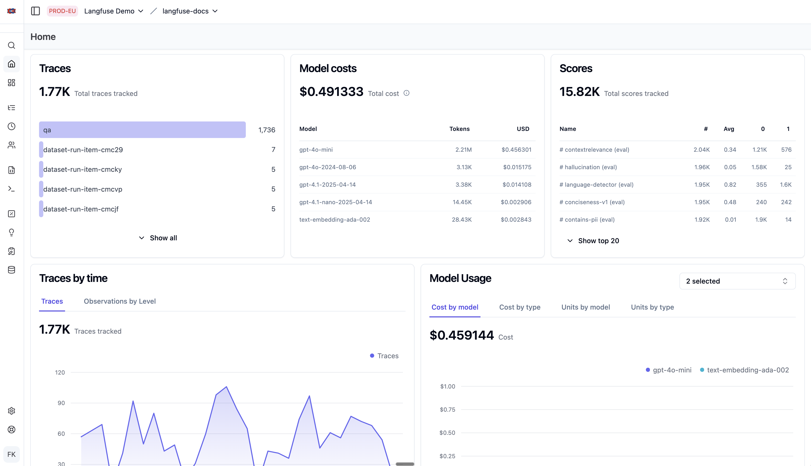

# A3 · Dashboard 与指标分析

| 页面属性 | 内容 |
|---|---|
| 负责人 | @HXl |
| 状态 | 草稿 |
| 适用 Langfuse 版本 | Python SDK v4（本机 4.15.0）；自托管部署核对记录为 4.46.0；界面核对版本：Dashboard v4.46.0、Scores v4.47.0 |
| 最后验证日期 | 2026-09-29（已核对 Dashboard 与 Scores 的可见字段和入口；筛选结果、页面跳转及沙箱实操尚未逐项验证） |
| 验证人 |  |

## 1. 适用人群与使用场景

开发、测试、业务和运维同事想知道“最近有没有变慢、模型用了多少 token、花了多少钱、哪里出错”，并从图表找到具体原因时，按本手册操作。

## 2. 前置条件

**账号权限**：能登录指定的 Langfuse 沙箱项目，查看 Home、Dashboards、Tracing 和 Scores；能阅读本章链接的仓库文档。核对告警运行情况时，由有权限的运维查看调度记录、日志和通知记录。

| 用途 | 环境变量名称与准备方式 |
|---|---|
| 打开 Langfuse 网页 | 从管理员处取得 `LANGFUSE_BASE_URL` 对应的入口；只看网页不用在本机配置密钥 |
| 开发排查“应用没有上报数据” | 核对 `ENABLE_LANGFUSE`、`LANGFUSE_BASE_URL`、`LANGFUSE_PUBLIC_KEY`、`LANGFUSE_SECRET_KEY`、`ENVIRONMENT`； |
| 查看告警规则及运行情况 | 阅读规则无需配置环境变量；运维核对 `M2_BASELINE_P95_MS`、`OTC_AGENT_URL`、`ALERT_STATE_FILE`、`WECHAT_ALERT_WEBHOOK_URL` 的配置情况，不在记录中填写变量值 |

## 3. 操作步骤

### 步骤 1：打开 Langfuse Home，认识各项指标

1. 打开[Home Dashboard](https://us.cloud.langfuse.com/project/cmo73j96z0049ad06k68jpadz/dashboards/langfuse-home-dashboard)，或从项目的 `Dashboards` 进入已有面板。
3. 按名称查看各张卡片。Dashboard 是这一整页看板，其中每张图或数字卡片叫 Widget。

| 卡片名称 | 用来回答什么问题 |
|---|---|
| `Traces` | 记录了多少条调用链，各名称分别有多少条 |
| `Model costs` | 各模型用了多少 token，记录了多少美元费用 |
| `Scores` 统计表 | 已有多少条评分，每种评分的数量、平均值和取值分布是什么 |
| `Observations by time` → `Observations by Level` | 哪些时段步骤记录增加，不同日志级别怎样分布 |
| `Model Usage` | 模型费用和用量随时间怎样变化 |
| `User consumption` | 哪些 User ID 对应的 Trace 数量或 token 费用较多 |
| `Scores`，副标题 `Moving average per score` | 各种评分的移动平均值随时间怎样变化 |
| `Trace latency percentiles`、`Generation latency percentiles`、`Observation latency percentiles` | 按不同记录名称查看耗时分位数，操作见步骤 4 |
| `Model latencies` | 各模型调用的耗时分位数随时间怎样变化 |
| `Scores Analytics` | 选定一个评分后，查看它的聚合统计与均值趋势 |

4. 读数字时，再分清下面几组词：

| 词 | 含义 |
|---|---|
| Trace / Observation / Generation | 一条调用链 / 链中的一次执行步骤 / 专门记录模型调用的一类步骤。查模型 token、费用和耗时，后面优先选 Generation |
| P50 / P90 / P95 / P99 | 将耗时从短到长排列，约 50% / 90% / 95% / 99% 的样本不超过这个值；都不是成功率，P95 也不是最大耗时 |
| Sum / Average / Count | 合计 / 平均 / 数量；看总花费用 Sum，看单次平均花费用 Average，看记录数量用 Count |

例如，**模型调用**的 P95 是 4 秒，表示这批模型调用中约 95% 不超过 4 秒；它不保证用户在 4 秒内收到回复。只有几条样本时，也不要把一次波动当成稳定趋势。

### 步骤 2：设置时间、Env 和模型范围

1. 点击时间选择器 `7d / Past 7 days`，表示过去 7 天；排查某次问题时，改成包含该问题的时间段，记下起止时间和页面时区。计算前后两个总数时，尽量使用固定起止时间，避免滚动时间范围变化。
2. 点击 `Env`。显示 `4 selected`，表示同时选中了 4 个环境；先展开确认具体选项，再选择本次要分析的测试环境。
3. 打开 `Filters`，核对是否存在其他限制。记录实际启用的条件；到 Tracing 查样本时沿用这些条件。
4. 查看 `Model Usage` 和 `Model latencies` 各自的模型选择框。截图显示一个模型名及 `+9`，表示还有其他模型被选中；需要比较指定模型时，分别在这两张卡片中核对选择，不能假定改了一张图就会同步另一张。
5. 阅读曲线时，将鼠标移到点或线段上，核对时间、图例、数值和单位。截图中的数字仅代表截图当时的范围，分析时以实际页面为准。

### 步骤 3：读 Traces、Observations 和用户用量，核对调用数量

1. 查看 `Traces`：`Total traces tracked` 表示调用链总量，横条按名称展示数量。
2. 看 `Observations by time`：当前标签为 `Observations by Level`，大数字是步骤记录量，曲线显示它随时间的变化。
3. 查看 `User consumption`。选择 `Count of Traces` 看各 User ID 的调用链数量，选择 `Token cost` 看费用。这里按应用传入的 User ID 分组。
4. 要取得模型调用数，进入 `Tracing`，沿用步骤 2 的时间和环境，选择 `Type = GENERATION`。清除 `Is Root Observation` 限制，让模型子步骤可以进入列表；不要改成只选根或只选非根。
5. 按要分析的模型名称筛选，暂不添加 `Level = ERROR`。若页面显示筛选结果总数，将它记为 N；只显示当前页条数时，不要把它当总数，可按步骤 6 的可选 Chart 方法核对。

### 步骤 4：读三张延迟表，再看 Model latencies 趋势

1. 查看 `Trace latency percentiles`、`Generation latency percentiles` 和 `Observation latency percentiles`。它们都有 `p50`、`p90`、`p95`、`p99` 列，截图中的 `p95 ▼` 表示当前按 P95 降序排列。先查看 P95 较高的记录；行数多时，在卡片内滚动查看。

| 表格标题 | 名称字段 | 怎么用 |
|---|---|---|
| `Trace latency percentiles` | `Trace Name` | 按调用链名称找慢的入口或评测任务，再查它包含哪些步骤 |
| `Generation latency percentiles` | `Generation Name` | 按记录名称找线索；这一列不是模型名，使用前要到详情核对记录类型 |
| `Observation latency percentiles` | `Observation` | 按步骤类型与名称找慢步骤，截图中能看到 `CHAIN` 类型 |

2. 记下名称、分位数和单位。
3. 查看 `Model latencies`，副标题为 `Latencies (seconds) per LLM generation`。核对模型选择框，再点击 `95th Percentile` 看 P95 趋势，其他同理；
4. 沿图例辨认模型，找到耗时升高的点或线段，记下模型和时间。纵轴是耗时，横轴是时间；
5. 进入 `Tracing`，沿用时间、环境和模型条件，选择 `Type = GENERATION` 并清除根限制。在 `Columns` 中显示 `Latency (s)`，按耗时降序打开一条慢记录，按 [A1](./a1-trace-troubleshooting.md)查看模型调用和上下游。

### 步骤 5：读 Model costs，切换 Model Usage 的四个标签

1. 查看 `Model costs`。`Total cost` 表示总费用，`Model`、`Tokens`、`USD` 三列分别表示模型名称、用量、美元费用。
2. 查看 `Model Usage`，核对选择的模型，再按要回答的问题切换标签：

| 标签 | 看什么 |
|---|---|
| `Cost by model` | 按模型区分费用趋势 |
| `Cost by type` | 按用量类别区分费用，例如输入、输出；具体类别看图例 |
| `Usage by model` | 按模型区分用量趋势 |
| `Usage by type` | 按用量类别区分用量，例如输入、输出或缓存；具体类别看图例 |

3. 比较两个长度相同、环境和模型一致的时段，将用量、费用与步骤 3 的模型调用数一起看。调用量也增加时，可能只是使用次数增加；调用量差不多，就查单次用量。只有费用记录完整、统计范围一致时，才用“总成本 ÷ 模型调用数”辅助比较单次平均成本。
4. 回到 `Tracing`，使用相同范围，显示 `Input Tokens`、`Output Tokens`、`Total Tokens` 和成本列。按总 token 或成本降序，打开一条高用量记录，核对是否带了较多历史、引用或 Excel 内容；

成本为空或为零时，先让开发检查 usage、模型匹配和价格来源，本次不改模型价格。依据见 [Token & Cost Tracking](https://langfuse.com/docs/observability/features/token-and-cost-tracking)。

### 步骤 6：做错误分析

本步骤统计同一范围内，已上报模型调用中被标记为 ERROR 的数量与占比。

页面中 `Observations by time` 展示步骤数量与级别，未展示一个单独的模型错误率数值。不能用全部 Observation 数量或 `Traces` 总量作为模型错误率的分母。

1. 回到 `Tracing`，恢复步骤 3 的固定时间、环境、模型和 `Type = GENERATION` 条件，清除根限制和错误级别筛选。再次核对这批全部模型调用的总数 N。
2. 只增加 `Level = ERROR` 条件（部分页面显示为 Status），读取相同范围的错误记录总数，记为 E。不要改变时间、模型或其他筛选。
3. N、E 都取得同一范围的总数后，计算 `E ÷ N × 100%`，将结果记录为“模型 Observation 的 ERROR 占比”。例如测试数据有 20 次模型调用，其中 2 次标成 ERROR，占比就是 10%；这是算术示例，不是项目告警阈值。N 为 0 时记“无样本”；只知道当前页条数或总数不完整时，记“待核对”，不计算整体占比。
4. 从筛选结果打开一条错误记录，记录发生时间、原因和 Observation ID；按 [A1](./a1-trace-troubleshooting.md)查看上下游。查看完清除 ERROR 筛选，恢复全部模型调用的范围。

**这个占比只反映这批 Langfuse 记录的标记情况。** 一条请求可能有多个错误节点；HTTP 返回成功也可能带着业务拒绝或字段错误。模型 ERROR、HTTP 5xx、cascade 降级、数据集断言失败是不同问题，不能共用一个“错误率”标题。

其中，HTTP 5xx 表示服务端返回了这一类错误状态码；cascade 降级是指前面的步骤出错后，后续转入兜底处理。用例断言失败则表示实际结果没有满足预先写好的期望，未必发生了运行异常。

| 要回答的问题 | 去哪里核对 |
|---|---|
| 哪次模型调用报错、为什么 | Langfuse 的 Generation 记录与错误详情 |
| HTTP 服务是否在报 5xx | 应用 `/metrics` 的 HTTP 指标与项目告警记录，规则查看方式见步骤 8 |
| 多少请求走了 cascade 兜底 | 项目的 fallback 指标与 HTTP 请求数 |
| 参数或意图是否符合用例期望 | 对应用例的确定性评分与差异，见[评分规则](../../adr/0005-annotation-roles-judge-plus-business-spotcheck.md) |

**可选：在 Chart 中查看数量和趋势。**

1. 在 `Tracing` 点击 `Chart`，使用 `Filters` 或搜索框限定记录范围。统计模型调用时，`Type` 只选 `GENERATION`，并确保 `Is Root Observation` 同时包含 `True` 和 `False`；核对 `Name`、时间、环境和模型条件。
2. 在 `Visualize` 中设置图表：

| 选项 | 怎么设置 |
|---|---|
| `Chart type` | 选 `Number` 查看整个时间范围的记录总数；选 `Line` 查看数量随时间的变化。`Area`、`Bars` 也用于时间趋势，`Ranked`、`Pie` 用于分组排名和占比 |
| `Metric` | 选 `Count`，统计符合条件的记录数量 |
| `Aggregation` | 使用 Count 时显示 `Count`，保持该值即可 |
| `Breakdown` | 选 `Type`，按记录类型分组；折线图用不同颜色区分 `CHAIN`、`GENERATION`、`AGENT`、`TOOL`、`SPAN` 等实际有数据的类型。`Number` 显示总数，不按此项拆分 |

3. 使用 `Line`、`Count` 和 `Type` 时，图表标题为 `Count of events by type over time`。按图例区分记录类型，将鼠标移到曲线上查看时间和数量。统计模型调用时仍只保留 `GENERATION`，不能把其他步骤数量一起计入。
4. 计算模型错误占比时，先用 `Number` 记录全部模型调用数 N，再只增加 `Level = ERROR` 筛选，记录错误数 E；保持其他条件一致。要查看错误随时间的变化，保留 ERROR 筛选，将 `Chart type` 切为 `Line`。
5. 检查变灰或划掉的筛选条件。metadata、全文检索、数值筛选等可能不参与图表计算；必要条件未生效时，不用该图表总数计算原范围的错误占比。查看完成后点击 `Table` 返回记录列表。

筛选支持范围见 [Chart any table](https://langfuse.com/docs/observability/features/events-table-charts)。

### 步骤 7：在 Scores 中筛选评分，查看结果并追溯原因

1. 进入 `Evaluation` → `Scores`，选择 `Scores` 标签和 `Table` 视图。通过 `Past 7 days` 时间选择器设置要查看的时间范围。每一行是一条评分记录；同一条业务记录可以对应多项评分。
2. 在搜索框输入评分名称并应用筛选，例如 `name:det_business_pass` 或 `name:det_intent_match_pass`，再核对结果中的 `Name`。需要限定评分来源时，可追加 `source:API` 或 `source:EVAL`；来源按实际写入方式选择，不根据评分名称猜测。搜索语法见[官方筛选说明](https://langfuse.com/docs/observability/features/filter-search-bar)。
3. 在 `Table` 中读取以下字段；需要调整显示字段时使用 `Columns`：

| 字段 | 怎么读 |
|---|---|
| `Timestamp` | 评分记录的时间；用于查找目标时段，不能单凭它判断业务重新执行过 |
| `Name` | 评分项名称，例如 `det_business_pass`、`det_intent_match_pass`；先确认自己查看的是哪一项 |
| `Value` | 这条评分的结果；布尔型可以显示 `True` / `False`，数值型可以显示 `1.00` / `0.00` 等数值，含义以该评分的定义为准 |
| `Comment` | 评分说明、断言结果或补写原因；与 Value 一起读，不能只看分数 |
| `Trace` | 关联调用链的链接，用于查看输入、输出和执行过程 |
| `Observation` | 关联执行步骤的链接，用于查看这条评分对应的具体步骤 |
| `Session` | 关联会话；为空时只表示此处没有显示会话关联，不能据此判断业务没有会话 |

4. 先看 `Value`，再读 `Comment`。发现失败值或需要复核的说明时，点击该行的 `Trace` 或 `Observation`，按 [A1](./a1-trace-troubleshooting.md)核对期望、实际输出和断言差异。如果 Comment 说明评分是根据已保存结果补写、没有重新执行业务，就沿关联记录核对原执行时间，不把新出现的评分当成一次新的业务调用。
5. 查看 `Count` 柱状图，了解评分记录在哪些时段增多。它统计的是评分数量，不是调用次数或通过率；不同名称、来源和类型的评分不能直接混算成一个业务通过率。
6. 需要切换显示方式时点击 `Chart`；需要进一步分析评分时进入 `Analytics` 标签。切换后重新核对时间、评分名称、来源及实际采用的统计指标；查看单条结果时返回 `Scores` → `Table`。

查不到预期评分时，先核对时间、名称和来源，再到对应 Experiment 或关联 Trace 查看。环境与查看入口见[现有手册 §5.1](../workflow-guide.md#51-environment-与评分查看位置)，来源定义见 [§5.2](../workflow-guide.md#52-score-source)。评分及验收规则仍以 [ADR 0005](../../adr/0005-annotation-roles-judge-plus-business-spotcheck.md) 和[评测链路说明](../workflow-guide.md#5-执行-experiment)为准。

### 步骤 8：查看告警阈值与处理规则

项目已提供告警规则和执行脚本，是否已定时运行、通知是否送达仍待核实。查看规则不需要 Grafana，也不需要启动告警脚本。

1. 打开[可观测性文档 §3「告警」](../../operations/observability.md#3-告警)，按问题找到对应告警名称：HTTP 服务错误、cascade 降级、模型调用失败、灰度白名单外流量或端到端延迟升高。已有告警记录时，直接按记录中的名称查找。
2. 打开 [ADR 0019 §1「自动告警」](../../adr/0019-incident-severity-thresholds.md#1-自动告警appobservabilityalertspy)，找到同名规则，核对阈值、持续时间、严重级别和触发动作。P0、P1、P2 是故障等级，数字越小越紧急。涉及 P95 时，请运维确认 `M2_BASELINE_P95_MS` 是否采用当前部署的实测基线，不把历史参考值当成当前环境的测量结果。
3. 核对用于判断的指标。项目告警读取应用 `/metrics`，指标定义见[可观测性文档 §2](../../operations/observability.md#2-指标)。步骤 6 算出的 Langfuse ERROR 占比不能直接代替 HTTP 5xx 率、cascade 降级率或项目 LLM 失败率。当前程序按相邻两次采集之间新增的计数计算比率，P95 则取进程累计的耗时分布；“持续越线多久”和“统计了哪个时间范围”要分开核对。
4. 需要确认告警是否实际生效时，请运维核对 [run_alerts.py](../../../scripts/run_alerts.py) 的定时执行记录、最近一次评估日志、告警状态和通知记录。脚本直接读取应用指标，不依赖 Grafana 或 Prometheus 服务；未配置 `WECHAT_ALERT_WEBHOOK_URL` 时只记录日志，不推送企微。没有运行或送达证据时，记“待核对”，不能因仓库有代码或 Dashboard 有异常就认定告警已触发。
5. 发生实际故障时，按 [ADR 0019 §2「人工升级判定」](../../adr/0019-incident-severity-thresholds.md#2-人工升级判定与-docsoperationson-call-runbookmd-3-对应)核对是否需要人工升级，再查[值班手册 §2–3](../../operations/on-call-runbook.md#2-角色与联系方式)确定联系角色、响应时间和处理责任。具体排查见[值班手册 §5](../../operations/on-call-runbook.md#5-常见故障处置-playbook)；回切等操作由对应负责人按手册执行。
6. 记录告警名称、发生时间与时区、指标值、持续情况、规则链接和处理状态。有对应请求时，按 [A1](./a1-trace-troubleshooting.md)通过 Trace ID 或业务关联信息查到具体记录，再查看出错步骤和上下游。尚未取得的告警日志或请求关联信息记“待核对”。

| 工具或文档 | 用来做什么 | 当前使用范围 |
|---|---|---|
| Langfuse Dashboard / Tracing | 看调用趋势，查具体步骤的输入、输出和错误 | 按前面步骤查看已有数据 |
| 项目告警程序与 ADR 0019 | 根据应用指标判断是否达到故障条件 | 查看规则；调度和通知是否启用由运维核实 |
| 值班手册 | 确定谁处理、多久介入、怎样排查和升级 | 按故障类型查处理流程 |
| Prometheus / Grafana | 收集指标并展示服务趋势 | 当前本机未运行这两个服务；仓库提供[面板模板与导入说明](../../../infra/grafana/README.md)，远程是否部署尚未核实 |

**上线观察标准与故障告警阈值用途不同。** [ADR 0030 D3](../../adr/0030-goal-restatement-native-langgraph-dataset-eval-harness.md)用于判断是否已稳定，[ADR 0019](../../adr/0019-incident-severity-thresholds.md)用于判断故障如何升级处理。阈值、持续时间和评分口径都以仓库真源为准，本手册不另存一套数值。

仓库资料与当前实现的差异已记入[资料审阅记录的 A3 部分](../../reports/2026-09-29-langfuse-manual-source-review.md#a3-补充审阅记录2026-09-29)，由审阅人核对后修改真源。

## 4. 验证：做完后应该看到什么

**查看范围已明确**：已打开已有 Dashboard，记录项目、固定起止时间、时区和 `Env`，并分别核对 `Model Usage`、`Model latencies` 的模型选择。

**调用数量已分清**：分别读到 `Traces` 的调用链数量、`Observations by time` 的步骤数量和 `User consumption` 的用户用量；模型调用数来自相同范围的 `GENERATION` 记录，包含根与非根记录，使用筛选结果总数。

**延迟结果可解释**：已记录三张延迟表的记录名称、分位数和单位；`Model latencies` 选择 `95th Percentile` 后查看 P95。能区分模型调用、其他步骤和 HTTP 请求的耗时，不将父子步骤的耗时相加。

**用量与费用已核对**：已查看 `Model costs` 的 `Model`、`Tokens`、`USD`，并切换 `Model Usage` 的四个标签；记录费用是否缺失，未把零费用或 `No data` 当成没有调用。

**错误占比有明确依据**：N 是同一范围的全部模型调用数，E 是只增加 `Level = ERROR` 后的数量。只有 N 大于 0、两个总数完整且其他条件相同时，才记录 `E ÷ N × 100%`；结果名称为“模型 Observation 的 ERROR 占比”。

**具体记录可追溯**：有慢调用、高用量或错误样本时，已按相同范围打开记录，核对模型、耗时、用量或错误原因，并记录 Trace ID / Observation ID；没有相应样本时注明尚未验证该类定位。

**评分结果可追溯**：已在 `Scores → Table` 按名称和来源筛选，读取 `Timestamp`、`Name`、`Value`、`Comment`，并核对可用的 `Trace` / `Observation` 关联。`Count` 表示评分记录数；评分补写不当成业务重新执行。

**告警规则与状态已分开记录**：已从 ADR 0019 查到对应规则，从值班手册找到处理角色和流程。告警调度、评估日志、状态和通知有证据才记录为已核实；否则记“待核对”。查看规则不要求 Grafana 已部署，也不要求触发一次告警。

使用可选图表时，再确认：`Tracing → Chart` 的 `Number + Count` 用于数量、`Line + Count` 用于趋势，参与计算的筛选条件已核对；在 `Scores` 切换 `Chart` 或 `Analytics` 后，重新核对评分名称、来源、时间与统计对象。未使用这些入口时可记“不适用”。

## 5. 常见问题

| 问题 | 怎么处理 |
|---|---|
| 面板空白，是不是系统没运行 | 核对项目、时间、时区、`Env` 和 `Filters`，再到 `Tracing` 找已知记录；仍找不到时请开发检查上报情况。无数据不能证明系统未运行或没有错误 |
| 改了筛选，几张图的结果仍对不上 | 分别核对卡片的模型选择、统计对象和时间范围，不能假定一张图的模型选择会同步到另一张；仍不一致时交维护人核对查询 |
| Traces、Observations、User consumption 的数量为什么不同 | 它们可能分别统计调用链、执行步骤或按用户分组的数据。先核对各自范围，不相加；模型调用数按步骤 3 从 `GENERATION` 记录取得 |
| Model latencies 显示的是 P95 吗 | 看实际选中的标签。`50th Percentile` 是 P50，`95th Percentile` 才是 P95 |
| Generation 延迟表出现评测任务名称，能当作模型耗时吗 | 先打开记录核对 `Type`、`Model` 和父子关系；名称或表格标题不足以证明它是一次模型调用。统计对象不明时记“待核对” |
| P95 上升，但平均耗时变化不大 | 可能是少量慢请求拉高了尾部耗时。核对样本量，再按步骤 4 找较慢记录；模型耗时与端到端耗时要分别比较 |
| 有 token，但费用为零或显示 No data | 查看 `Usage by model` 和单条记录，再请开发核对 usage、模型匹配与价格来源。保留实际显示值并注明费用是否完整，不将其解释为免费或没有调用 |
| token、成本总量上涨，是不是性能变差了 | 先比较相同时长、环境和模型下的调用量，再看单次用量。只有成本完整且统计范围一致时，才比较单次平均成本 |
| 只有当前页条数，或者 N 为 0，怎样算错误占比 | 当前页条数不能当总数，可用步骤 6 的 `Number + Count` 核对；总数仍不明确就记“待核对”。确认 N 为 0 时记“无样本”，不计算占比 |
| 切到 Chart 后数字和 Table 不一致 | 核对时间及全部筛选条件，尤其是变灰或划掉的条件。必要条件未参与计算时，不用图表总数计算原范围的错误占比 |
| ERROR 没有增加，业务结果仍然不对 | 运行错误与业务正确性不同。查看关联记录的实际参数、后端回复和确定性评分，按 A1 追溯原因 |
| Scores 找不到预期评分 | 核对时间、`Name` 和来源，先去掉不确定的筛选，再到对应 Experiment 或 Trace 查看；环境和评分查看位置见步骤 7 的仓库链接 |
| 同名评分为什么有多行，Value 为什么有 True 和 1.00 | 同名评分可以对应不同记录。`API`、`EVAL` 是来源，布尔型、数值型是数据类型；先核对关联对象、来源、类型和评分定义，再解释 Value。`Count` 统计评分记录数，不直接代表业务通过率 |
| 新增评分是否表示业务重新执行 | 看 `Comment`，再核对关联 Trace / Observation 的执行时间。按已保存结果补写评分，不等于重跑业务 |
| Langfuse 的 P95 或 ERROR 占比能直接判断项目告警吗 | 不能直接代替。先核对指标来源、统计对象和时间范围，再按 ADR 0019 核对阈值及持续时间；具体见步骤 8 |
| Dashboard 有异常，为什么没有收到告警 | 请运维分别检查定时执行、评估日志、告警状态和通知记录。`WECHAT_ALERT_WEBHOOK_URL` 未配置时只记录日志；没有证据时记“待核对”，不能认定告警已启用或已送达 |
| 没有 Grafana，还能查看告警规则吗 | 可以。按步骤 8 查看 ADR 0019 和值班手册；项目告警脚本直接读取应用 `/metrics`，不依赖 Grafana 或 Prometheus 服务 |
| 已有面板缺少指标，或者同事打不开 | 缺少指标时到 `Tracing` 查看具体记录，必要时用 `Chart` 查看支持的统计；访问失败时请管理员核对项目权限。无法核实的结果保留为“待核对” |

## 6. 本项目不用的功能及原因

表中“项目约定”说明已有规则；“本章不操作”说明本手册的范围，不表示平台没有这些功能。

| 功能或做法 | 适用范围 | 原因与处理方式 |
|---|---|---|
| 用 LLM Judge 做本项目数据集的批量评分 | 项目约定 | 采用确定性断言，评分规则见 [ADR 0005](../../adr/0005-annotation-roles-judge-plus-business-spotcheck.md)；分析时查看已有 Score 与差异 |
| 在 Langfuse 修改生产提示词 | 项目约定 | 提示词真源在 Git，管理方式见 [ADR 0014](../../adr/0014-langfuse-as-harness-backend.md) 和 [ADR 0023](../../adr/0023-prompt-as-code-langgraph.md) |
| 用平台原生 Alerts 另定项目故障阈值 | 项目规则仍以 ADR 0019 为准 | 平台告警功能与项目告警程序要区分；本章只查看仓库规则，不另建一套阈值或推断平台通知已经接通 |
| 启用通知、修改阈值或运行告警脚本来测试推送 | 本章不操作 | 本章核对运行与通知证据；通知接线和规则变更按运维流程处理 |
| 保存或覆盖共享面板、设置项目默认首页 | 本章不操作 | 查看已有 Dashboard，临时切换筛选或图表；共享设置会影响其他使用者 |
| 修改模型价格、评分配置、数据集、账号或权限 | 本章不操作 | 发现缺失或异常时交维护人核对，不为补齐图表或提高分数改变配置与数据 |
| 部署 Grafana / Prometheus、导入面板或升级 SDK / 自托管服务 | 本章不操作 | 这些属于部署维护；查看告警规则不依赖 Grafana，仓库模板也不代表服务已运行 |
| 将客户 Trace 公开分享或上传外部分析平台 | 本章不操作 | Trace 可能包含客户原文和交易参数；使用指定沙箱，附图采用测试数据或先脱敏 |

## 7. 参考：仓库文件路径、ADR 编号、Langfuse 官方文档链接

**仓库文件与 ADR**：字段、评分、提示词和告警规则以这些文件为准。发现差异时记录给审阅人，不在手册中另写一套规则。

| 查什么 | 仓库文件路径 | ADR |
|---|---|---|
| 应用指标的含义与来源 | [docs/operations/observability.md](../../operations/observability.md)、[app/observability/metrics.py](../../../app/observability/metrics.py)、[app/observability/llm_metrics.py](../../../app/observability/llm_metrics.py) | [ADR 0019](../../adr/0019-incident-severity-thresholds.md)用于告警判定 |
| 告警阈值、持续时间与执行入口 | [app/observability/alerts.py](../../../app/observability/alerts.py)、[scripts/run_alerts.py](../../../scripts/run_alerts.py) | [ADR 0019 §1–2](../../adr/0019-incident-severity-thresholds.md#1-自动告警appobservabilityalertspy) |
| 处理角色、响应时间与故障排查 | [docs/operations/on-call-runbook.md](../../operations/on-call-runbook.md) | [ADR 0019](../../adr/0019-incident-severity-thresholds.md) |
| 上线观察标准与故障阈值的区别 | [docs/operations/observability.md](../../operations/observability.md) | [ADR 0030 D3](../../adr/0030-goal-restatement-native-langgraph-dataset-eval-harness.md)、[ADR 0019 §4](../../adr/0019-incident-severity-thresholds.md#4-与-adr-0030-d3-上线观察层的关系) |
| Trace 排障与筛选 | [docs/langfuse/developer-manuals/a1-trace-troubleshooting.md](./a1-trace-troubleshooting.md)、[docs/langfuse/developer-manuals/a2-sessions-users-tags-filters.md](./a2-sessions-users-tags-filters.md) | [ADR 0031](../../adr/0031-single-model-request-per-message.md)规定模型请求次数边界 |
| 评分查看位置、来源与数据集规则 | [docs/langfuse/workflow-guide.md §5.1–5.2](../workflow-guide.md#51-environment-与评分查看位置)、[tests/datasets/README.md](../../../tests/datasets/README.md) | [ADR 0005](../../adr/0005-annotation-roles-judge-plus-business-spotcheck.md) |
| 提示词真源与管理规则 | [docs/langfuse/workflow-guide.md](../workflow-guide.md) | [ADR 0014](../../adr/0014-langfuse-as-harness-backend.md)、[ADR 0023](../../adr/0023-prompt-as-code-langgraph.md) |
| Grafana 模板与导入说明 | [infra/grafana/README.md](../../../infra/grafana/README.md)、[infra/grafana/dashboards/otc-agent-overview.json](../../../infra/grafana/dashboards/otc-agent-overview.json) | 故障阈值见 ADR 0019，上线观察见 ADR 0030 |
| 版本核对、资料差异与待验证项 | [docs/reports/2026-09-29-langfuse-manual-source-review.md](../../reports/2026-09-29-langfuse-manual-source-review.md) | — |

**Langfuse 官方文档**：用于查平台功能和字段含义；本项目的使用规则仍按仓库文档执行。

| 查什么 | 官方文档 |
|---|---|
| Dashboard 与已有图表的概念 | [Metrics 总览](https://langfuse.com/docs/metrics/overview)、[Custom Dashboards](https://langfuse.com/docs/metrics/features/custom-dashboards) |
| v4 的 Dashboard 变化 | [Dashboard changes in v4](https://langfuse.com/faq/all/dashboard-changes-in-v4) |
| Table / Chart、图表类型和筛选支持范围 | [Chart any table](https://langfuse.com/docs/observability/features/events-table-charts) |
| `name:`、`source:` 等搜索语法 | [Filter search bar](https://langfuse.com/docs/observability/features/filter-search-bar) |
| token 用量、模型匹配与费用记录 | [Token & Cost Tracking](https://langfuse.com/docs/observability/features/token-and-cost-tracking) |
| Score 的字段与数据类型 | [Scores](https://langfuse.com/docs/evaluation/scores/overview) |
| Scores 的 Analytics 功能 | [Score Analytics](https://langfuse.com/docs/evaluation/scores/score-analytics) |
| 平台原生告警能力，用于理解与项目告警的区别 | [Alerts](https://langfuse.com/docs/observability/features/alerts) |

以下为[官方 Metrics 文档](https://langfuse.com/docs/metrics/overview)的旧版 Demo 界面，仅作补充示意；

