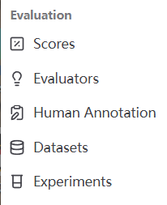
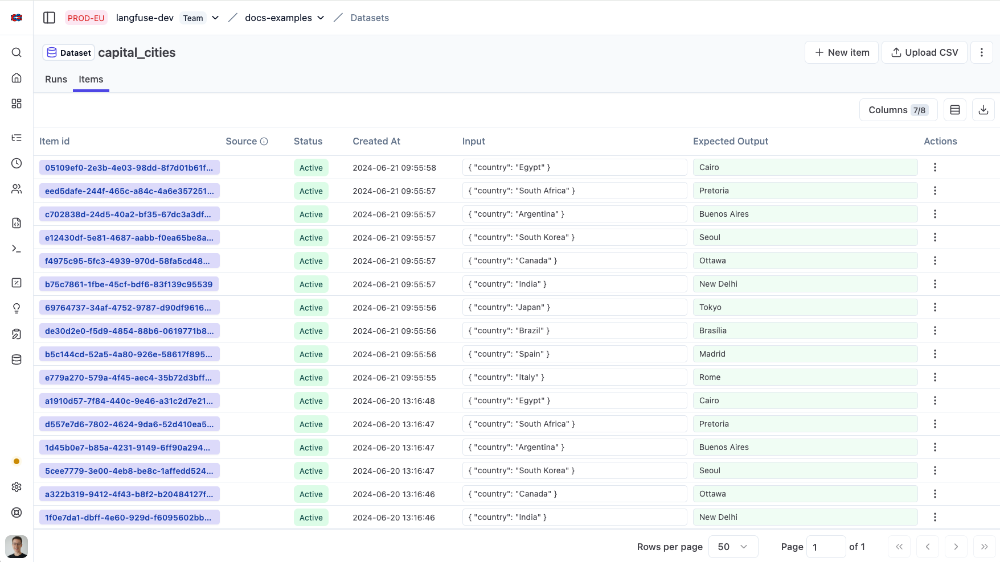

# A4 · Dataset 管理（界面）

| 页面属性 | 内容 |
|---|---|
| 负责人 | @HXL |
| 状态 | 草稿 |
| 适用 Langfuse 版本 | Python SDK v4（本机 4.15.0）；自托管版本核对记录为 4.46.0，沿用同日资料审阅记录； |
| 最后验证日期 | 2026-09-29（已核对仓库实现、官方文档、图片和本地预览命令；沙箱界面操作待验证） |
| 验证人 |  |

## 1. 适用人群与使用场景

开发、测试和业务同事需要找到一条测试用例、看懂输入与预期结果，或核对 Git 中的用例是否已发布到 Langfuse 时，按本手册操作。

## 2. 前置条件

**账号权限**：能登录指定沙箱项目并查看 `Datasets`；通常只需 `Viewer` 的查看权限，具体以管理员分配为准，见官方 [访问控制说明](https://langfuse.com/docs/administration/rbac)。

| 用途 | 环境变量名称与准备方式 |
|---|---|
| 打开网页 | 从管理员处取得 `LANGFUSE_BASE_URL` 对应的入口；只看网页不需要本机配置密钥 |
| 本地预览命令 | 不需要 Langfuse 环境变量；需要仓库和已经安装项目依赖的 Python 环境 |
| 发布失败时，由维护人检查 | `LANGFUSE_BASE_URL`、`LANGFUSE_PUBLIC_KEY`、`LANGFUSE_SECRET_KEY`、`LANGFUSE_TIMEOUT`；只记录是否已配置，不把值写入手册或反馈 |

## 3. 操作步骤

### 步骤 1：分清“用例”和“运行结果”

1. 在 `Evaluation` 分组选择 `Datasets`。
2. 先分清这四个词，再开始查找。

| 名称 | 通俗解释 |
|---|---|
| Dataset（数据集） | 一组测试用例，类似一本题册 |
| Item（用例） | 题册里的一道题，保存输入、预期结果和说明；一道题也可以包含多轮对话 |
| Experiment（实验） | 用这组题实际测一次系统，记录这次的输出 |
| Score（评分） | 按既定规则检查实际输出后得到的分数或结论 |

**用例存在，不代表已经运行；用例是 Active，也不代表测试通过。** 对象关系详见 [功能指南 §2](../workflow-guide.md#2-对象与评测链路)。



图 1：仓库已有的导航截图，仅含功能名称。

### 步骤 2：找到数据集，打开 Items

1. 在 `Datasets` 列表找到负责人提供的完整名称。名称含 `/` 时，按文件夹逐级打开；例如 `biz/option_inquiry` 对应 `biz` 文件夹内的 `option_inquiry`。
2. 点击数据集名称，核对页面显示的完整名称，避免进入同名尾缀的另一组用例。
3. 选择 `Items` 页签。这里看测试内容；`Experiments` 页签看已有运行结果，本次无需启动实验。
4. 若页面提供版本选择，先选择最新版本，并记录页面显示的版本。没有版本入口时，先按当前内容查找，将版本核对交给维护人。
5. 在 `Columns` 中确认显示 `Item id`、`Status`、`Input`、`Expected Output`、`Metadata`。条目较多时，用 `Rows per page` 和 `Page` 翻页。



图 2：来自官方 [Datasets 文档](https://langfuse.com/docs/evaluation/experiments/datasets)的[示例截图](https://langfuse.com/images/docs/datasets-overview.png)，使用 `docs-examples / capital_cities` 测试数据，展示国家与首都。它用于辨认列名；旧版的 `Runs` 对应运行记录入口，项目现有界面称为 `Experiments`。这不是本项目的用例或实机验证结果。

本项目数据集的命名与来源见 [自动同步说明](../auto-sync.md#数据集会怎样更新)。先核对完整名称，不把所有带 `option` 的数据集都当成当前基线。

### 步骤 3：筛选用例，再核对命中内容

1. 在 `Items` 清空 `Search`，移除已有的 `Filters` 条件，避免沿用别人留下的筛选。
2. 打开 `Filters`，选择状态字段 `Status`，只保留 `Active`，查看当前启用的用例。
3. 在 `Search` 按输入框提示搜索负责人提供的 Item ID。完整 ID 含特殊字符时，用英文双引号包住；搜索后按回车，并检查页面是否提示查询无效。
4. 点击命中行的 `Item id`，核对完整 ID 及 `Metadata` 中的原始用例编号。搜索可能命中多条，不能只看列表的第一条。
5. 需要按类别查一批时，清掉 ID 搜索。在 `Filters` 中选择 `Metadata`，选择实际存在的键，例如 `category`，按页面提供的等于条件填写该键的实际值。每次只增加一个条件，再检查结果。
6. 若当前版本没有该 Metadata 筛选项，保留状态条件，通过 `Metadata` 列和翻页核对；不要把 `Tracing` 的查询语法直接套到 Dataset 页面。
7. 要查历史停用用例，清掉搜索和类别条件，将状态条件换成 `Archived`。查完后恢复 `Active`。

| 你要查什么 | 用什么线索 | 查到后确认什么 |
|---|---|---|
| 某一条用例 | 完整 Item ID；不知道时先用原始用例编号搜索 | 完整 ID、Dataset 名称和 Metadata 编号是否都对应 |
| 某类用例 | Metadata 中实际已有的类别键和值 | 打开至少一条，确认类别与内容一致 |
| 已停用的用例 | Status = Archived | 状态确为归档；没有结果时再核对版本和发布记录 |

界面显示的 `Active` / `Archived` 是启用状态，接口中常写成 `ACTIVE` / `ARCHIVED`。归档用例通常不参加后续使用当前数据集的实验；固定历史版本的实验应核对当时版本。状态不表示通过或失败，见官方 [归档说明](https://langfuse.com/docs/evaluation/experiments/datasets#editarchive-dataset-items)。

本节的 `Search`、`Filters`、`Columns` 入口已从仓库既有 Items 页面核对；4.46.0 的筛选选项和搜索命中结果仍需沙箱实机验证。控件缺失时，记录版本和缺失的名称交负责人确认，不自行升级。

### 步骤 4：读懂一条用例，找到它在 Git 中的位置

1. 点击目标 `Item id`。如果打开的是可编辑表单，只查看内容，退出时不保存。
2. 阅读 `Input`：这是测试时交给系统的内容。多轮用例要逐轮展开，不能只读首轮。
3. 阅读 `Expected Output`：这是预先约定的正确结果或检查条件，不是系统这次已经回答的内容。
4. 阅读 `Metadata`：用它核对用例编号、名称、类别和来源。字段含义与多轮对应关系直接查 [功能指南 §3](../workflow-guide.md#3-dataset-数据结构)，本手册不另列一份字段契约。
5. 查找来源信息 `fixture_path`、`source_line` 和原始用例编号。在仓库的 `tests/datasets/` 中打开对应文件，再用编号定位该条用例；行号用于辅助查找，文件更新后可能移动。
6. 对照输入和预期，记录有疑问的具体字段。没有来源信息时，记录 Dataset 名称和完整 Item ID，请维护人查发布来源，不自行补填 Metadata。

例如，自动同步后的 `fixture_path` 为 `biz/option_inquiry.jsonl` 时，打开 [tests/datasets/biz/option_inquiry.jsonl](../../../tests/datasets/biz/option_inquiry.jsonl)。路径换成你的实际来源；不要把旧截图里的用例 ID 当成所有数据集通用的编号。

若要看“系统实际答了什么”，转到该数据集已有的 `Experiments`，选择指定运行及其用例记录；继续排障见 [A1 · Trace 查看与排障](./a1-trace-troubleshooting.md)。查看 Item 本身不会执行模型或交易请求。

### 步骤 5：用命令预览 Git 会发布哪些数据集（开发可选）

1. 在仓库根目录打开 PowerShell，使用已经安装好项目依赖的 `.venv`。
2. 执行只读预览命令，保留 `--dry-run`。

```powershell
.\.venv\Scripts\python.exe scripts/langfuse/upload_golden_to_langfuse.py --sync-all --dry-run
```

3. 查看输出中的 `dataset=`、`items=` 和 `source=`，找到步骤 2 的数据集，核对来源文件。
4. 如果预览报错，把文件名、行号和错误类型交给维护人。不要删除有问题的用例或放宽预期来绕过检查。

这个命令只检查当前本地文件并列出计划发布的对象，不连接 Langfuse，不上传、不归档，也不运行实验。它不能证明远端已同步，不能列出远端新增、更新、归档的实际差异。本地文件未必与 `main` 一致，发布核对还要完成步骤 7。依据见 [本地预览说明](../auto-sync.md#先在本地预览)。

没有开发环境的同事可跳过命令，请维护人提供预览结果；不必为查看用例安装或升级依赖。

### 步骤 6：发现用例有问题，提交修改线索

本项目现役 `biz/`、`intent/` 用例以经过审阅的 Git 文件为准，Langfuse 保存发布后的副本。修改流程是：

```text
发现疑问 → 记录用例与依据 → 业务方复核期望 → 修改 Git 文件并评审
→ 合入 main → 同步到 Langfuse → 核对发布结果
```

1. 保留完整 Dataset 名称、Item ID、当前版本（如能取得）和来源文件路径。
2. 写清楚“现在哪里不对、建议怎样改、依据是什么”。系统实际输出错误时，不能直接把错误输出改成标准答案。
3. 将记录交给 @HXl 或指定审阅人，由维护人按仓库流程处理。
4. 审阅期间不在界面修改 Input、Expected Output 或 Metadata，也不新增、归档或删除基线用例。

可直接使用这个记录格式；敏感内容用脱敏摘要：

```text
沙箱项目：
Dataset 完整名称 / 完整 Item ID：
页面版本（未显示则注明）/ 核对时间：
Git 来源文件 / 用例编号：
有疑问的字段：
当前内容摘要 / 建议修改 / 业务依据：
审阅人 / 关联的仓库修改记录：
```

**为什么不能直接在界面改？** 界面改动不会自动回写 Git。下次同步可能覆盖手工改动，Git 中仍保留的用例也会重新设为启用；同一数据集内仅在平台新增的用例可能被归档。这样会让本地与平台用不同题目验收，也失去统一的评审依据。具体更新和归档条件以 [自动同步规则](../auto-sync.md#数据集会怎样更新)为准。

单向发布针对本章的 `biz/`、`intent/` 基线，不表示 Langfuse 产品不能编辑数据集。平台标注如何经人工复核回到 Git，以及节点样本的独立流程，统一见 [ADR 0029 D5](../../adr/0029-node-level-debug-api-and-regression-workbench.md#d5--逐步迁移到-langfuse-回归闭环)。

### 步骤 7：核对一次已有发布的结果

1. 取得维护人提供的已合并修改记录，明确这次应新增、修改或停用哪几条用例。
2. 在 GitHub 仓库选择 `Actions`，打开 `langfuse-dataset-sync`，查看对应执行记录是否成功。核对检出的 `main` 提交与日志，不能只凭 PR 已合并就判断发布完成。
3. 请维护人确认这次同步的目标项目。同步凭据所属项目必须与正在查看的项目一致；本章只查看对应沙箱的记录，不触发面向正式项目的发布任务。
4. 回到 Langfuse 的目标 Dataset，刷新 `Items`，清除旧筛选，并确认查看的是最新版本。
5. 按步骤 3–4 逐条核对变化：新增项能找到，修改项内容符合已审阅文件，停用项按同步规则显示为归档。
6. 记录执行结果和不一致项。同步失败时不要在 UI 中补改；由维护人按 [自动同步操作说明](../auto-sync.md#在-github-网页上运行)排查。

**同步成功只表示数据发布完成，不表示实验通过。** 还没有运行记录或分数时，不在验证记录中写 PASS。删除或改名整个 Git 文件也不等于远端旧 Dataset 会自动消失，完整规则见 [数据集更新说明](../auto-sync.md#数据集会怎样更新)。

## 4. 验证：做完后应该看到什么

- [ ] 进入指定沙箱，找到完整名称一致的 Dataset，能打开 `Items`。
- [ ] 能按状态和用例编号缩小范围，并核对命中项的完整 ID。
- [ ] 能解释 Input、Expected Output、Metadata 的用途，知道 Expected Output 不是实际回复。
- [ ] 能区分 Active / Archived 与 PASS / FAIL，不把用例数量当成通过数量。
- [ ] 能按来源路径和用例编号找到 Git 文件；来源缺失时已记录交维护人核查。
- [ ] 如执行了预览命令，能找到对应的数据集名和来源；未执行则记“不适用”。
- [ ] 如核对了一次发布，Actions 记录与目标沙箱的用例变化相符；没有发布可核对则记“待验证”。
- [ ] 需要修改时已整理审阅线索，没有在界面改写基线，也没有把真实客户数据带入手册。

完成沙箱核对后，由实际操作人填写页面属性的验证日期、验证人和状态。资料核对通过不等于全部界面步骤已验证。

## 5. 常见问题

| 问题 | 怎么处理 |
|---|---|
| 看不到 Datasets 或项目 | 先核对组织和项目，再请管理员检查查看权限；不自行修改权限 |
| 数据集存在，但找不到用例 | 清除搜索和筛选，核对最新版本，再分别查看 Active、Archived；完整 Item ID 与原始用例编号可能不同 |
| Search 没命中或提示无效 | 核对本页输入提示，完整 ID 加英文双引号后再查；仍失败则清空搜索，通过状态、Metadata 和翻页定位，不套用 Tracing 查询语法 |
| Metadata 没有某个键 | 先看实际字段与来源。历史上传内容可能不同，不在界面补造字段；交维护人对照功能指南 §3 核查 |
| 页面与本地数量不一致 | 核对项目、数据集版本、状态条件、分页，以及本地文件是否与已发布的 main 一致；总数相同也不能代替逐条核对 |
| 预览成功，但页面没变化 | `--dry-run` 不上传；查看真正的发布执行记录和目标项目 |
| Git 已合并，页面仍是旧内容 | 检查是否触发同步、任务是否成功、检出了哪个 main 提交，以及查看的是否为目标项目和最新版本 |
| 同步报错后，有些用例却已更新 | 上传可能在中途失败，不能假设整次发布自动回滚；把任务日志与变化项交维护人核对，上传失败时不会进入后续归档阶段 |
| 界面改动后来消失了 | Git 同步可能覆盖手工修改；把修改依据交审阅人，通过 Git 修正，不反复在 UI 保存 |
| 有用例，却没有分数 | Dataset 保存测试内容；运行与评分是后续步骤。本次只核对数据，不点击 Run 来试探 |
| Expected Output 看起来不对 | 记录具体字段和业务依据，交业务方复核。不要按系统当前输出修改标准以提高通过率 |

## 6. 本项目不用的功能及原因

| 功能或做法 | 原因与替代操作 |
|---|---|
| 在 UI 直接维护现役 biz / intent 基线，包括 New item、Upload CSV、编辑、Archive、Delete | 这些入口是平台通用能力；本项目基线走 Git 审阅和单向发布，修改线索按步骤 6 提交 |
| 从 Trace 直接加入现役基线，并把实际输出作为预期 | 实际输出可能正是错误结果；先保留来源并由业务方复核，见 ADR 0005、ADR 0029 |
| 把平台导出内容自动覆盖 Git | 会形成两套可互相覆盖的标准；候选标注先复核，再进入 Git 发布流程 |
| 用 LLM Judge 自动补答案或裁定批量验收 | 项目使用确定性断言，业务期望由业务方复核，见 ADR 0005 |
| 在 Langfuse 修改 Prompt 作为生产发布 | 提示词真源仍在 Git；Dataset 页面也不负责发布生产提示词，见 ADR 0014 |
| 在 A4 中运行实验、修改评分规则、调整账号权限或升级部署 | 本任务只浏览与核对数据集；相关操作需要各自的流程和适用环境 |

## 7. 参考

手册及其 Notion 页面只说明怎么操作；字段、提示词真源和评分规则以仓库及 ADR 为准。资料不一致时，记录交审阅人处理，不在 Notion 建立另一套规则。

| 仓库资料 | 用途 |
|---|---|
| [docs/langfuse/workflow-guide.md §3–§4](../workflow-guide.md#3-dataset-数据结构) | 数据集字段与首次配置；字段解释从这里查 |
| [docs/langfuse/auto-sync.md](../auto-sync.md) | 单向发布、触发条件、更新与归档规则、本地预览 |
| [tests/datasets/README.md](../../../tests/datasets/README.md) | 现役数据集目录与用例组织方式 |
| [scripts/langfuse/upload_golden_to_langfuse.py](../../../scripts/langfuse/upload_golden_to_langfuse.py) | 本地预览与同步实现 |
| [.github/workflows/langfuse-dataset-sync.yml](../../../.github/workflows/langfuse-dataset-sync.yml) | main 分支的发布任务与配置名称 |
| [ADR 0005](../../adr/0005-annotation-roles-judge-plus-business-spotcheck.md) | 确定性评分与业务方复核职责 |
| [ADR 0014](../../adr/0014-langfuse-as-harness-backend.md) | 自托管数据边界、提示词真源与数据流向 |
| [ADR 0029 D5](../../adr/0029-node-level-debug-api-and-regression-workbench.md#d5--逐步迁移到-langfuse-回归闭环) | biz / intent 基线单向发布、候选标注复核与节点样本边界 |
| [资料审阅记录](../../reports/2026-09-29-langfuse-manual-source-review.md) | 原资料差异、图片来源与沙箱验证待办 |

Langfuse 官方资料：

- [Datasets](https://langfuse.com/docs/evaluation/experiments/datasets)：数据集、文件夹、版本和归档。
- [Experiments Data Model](https://langfuse.com/docs/evaluation/experiments/data-model)：测试内容与实验结果的关系。
- [Access Control](https://langfuse.com/docs/administration/rbac)：查看权限与项目访问。

官方资料可能随版本更新；本章不因此要求升级现有部署。
