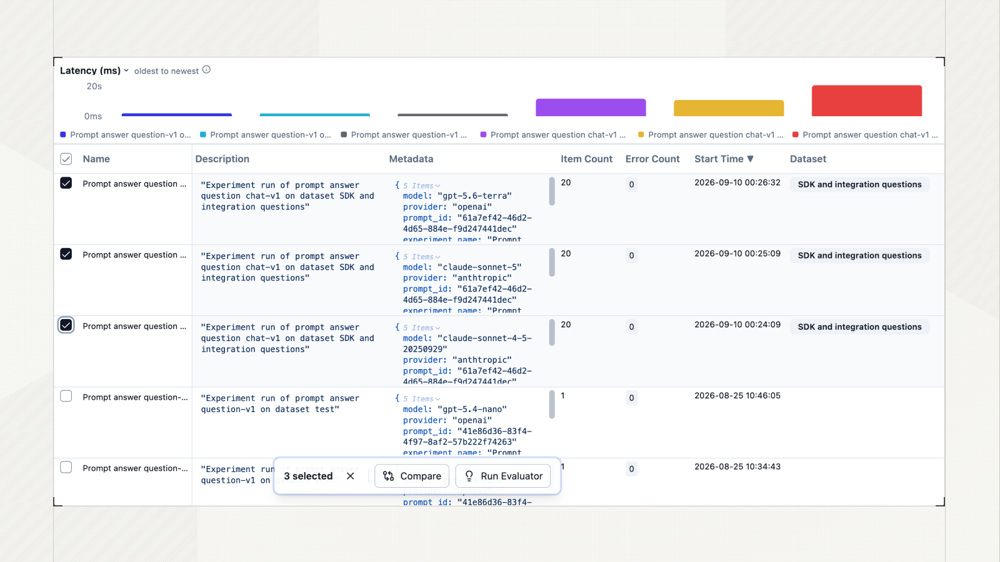
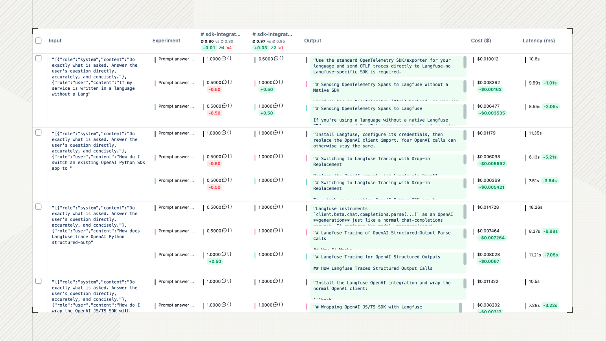
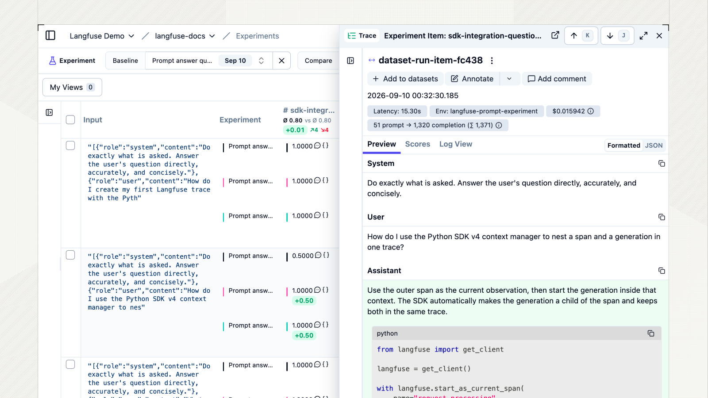

# A5 · Experiment 结果对比

| 页面属性 | 内容 |
|---|---|
| 负责人 | @HXl |
| 状态 | 草稿 |
| 适用 Langfuse 版本 | Python SDK v4（本机 4.15.0）；自托管 4.46.0（沿用同日资料核对记录，Experiment 页面待实机验证） |
| 最后验证日期 | 2026-09-29（仓库、官方文档、截图和本地预览命令；沙箱操作待验证） |
| 验证人 |  |

## 1. 适用人群与使用场景

开发、测试和业务同事需要比较两次测试、找出新增失败用例，并说明哪个结果与预期不符时，按本手册操作。

## 2. 前置条件

**账号权限**：能登录指定沙箱，查看 `Experiments`、关联 Trace 和 Scores；查看结果通常使用 `Viewer`，以管理员实际分配为准。

| 用途 | 需要的环境变量名称 |
|---|---|
| 打开网页 | 向管理员获取 `LANGFUSE_BASE_URL` 对应入口；只看网页无需在本机配置变量 |
| 本地预览命令 | 无需 Langfuse 环境变量；需仓库和已安装项目依赖的 Python 环境 |
| 找不到记录时，由开发核对配置 | `LANGFUSE_BASE_URL`、`LANGFUSE_PUBLIC_KEY`、`LANGFUSE_SECRET_KEY`、`ENABLE_LANGFUSE`、`ENVIRONMENT`；只反馈是否配置，不提供值 |

## 3. 操作步骤

### 步骤 1：找到要比较的两次运行

1. 登录并确认项目名称与指定沙箱一致。
2. 在 `Evaluation` 分组选择 `Experiments`。
3. 按负责人提供的完整运行名找到两条记录，核对时间。名称被缩短时，打开记录确认全名或 ID。
4. 若从平台数据集开始，也可进入 `Datasets`，打开指定数据集，再选择 `Experiments`。本地数据运行的实验从项目的 `Experiments` 查找。

先分清四个词：**Run** 是一次测试记录；**Baseline** 是本次比较的参照运行；**候选运行**是要检查是否有变化的运行；**Score** 是某条评分规则给出的结果。一次运行可以有多个 Score。

对象关系见 [功能指南 §2](../workflow-guide.md#2-对象与评测链路)，本地数据实验入口见官方 [Experiments Data Model](https://langfuse.com/docs/evaluation/experiments/data-model#local-datasets)。

### 步骤 2：确认两次结果可以比较

1. 查看两次记录的 `Metadata`、数据集信息和执行报告，逐项核对下表。
2. 查看 `Item Count` 和实际用例编号，确认两次包含同一批用例；数量相同也可能是不同用例。
3. 查看 `Error Count`、执行状态和未执行项。错误数为零不代表回答正确；运行完成也不代表评分已完成。
4. 信息缺失时请运行负责人补充，记录“待核对”，暂不作整批改善或通过的结论。

| 要核对什么 | 怎样才有可比性 |
|---|---|
| 测试内容 | 同一数据版本、同一用例范围，Input 和 Expected Output 一致；本地数据用 Git 版本或内容记录核对 |
| 评分规则 | 比较同名、同类型、同来源且规则版本一致的 Score；同名不保证实现未变 |
| 系统条件 | 记录代码、提示词、模型、后端模式及本次改动；未计划改变的条件保持一致 |

本章只整理对比证据。项目验收条件直接查 [ADR 0030 D3](../../adr/0030-goal-restatement-native-langgraph-dataset-eval-harness.md#d3--统一评测门)；改变模型、后端或测试范围时，不能直接沿用原基线的验收结论。

### 步骤 3：打开 Compare，指定 Baseline

1. 返回 `Experiments` 列表，勾选这两条运行记录。
2. 点击 `Compare`。
3. 在 `Baseline` 选择负责人指定的已审阅运行，在 `Compare` 保留待检查的候选运行。
4. 再核对两次完整运行名，避免把基线和候选选反。日期更新不代表已经获准作为基线。



图 1：官方文档测试数据，演示勾选运行与 `Compare` 入口；本章只选两次运行。来源：[官方对比说明](https://langfuse.com/docs/evaluation/experiments/compare-experiments)及[原图](https://langfuse.com/images/docs/experiment-comparison-selection.png)。

选择 `Baseline` 只改变本次查看的参照，不会发布代码或修改项目验收门。若当前版本缺少这些入口，记录版本和控件名称交负责人核对，不自行升级。

### 步骤 4：先看汇总，再读清 Score

1. 使用 `Columns` 显示需要的评分列、`Output`、`Cost` 和 `Latency`；如有 `Item ID`，也一并显示。
2. 核对每列对应的评分名称和运行名。汇总百分比或平均数表示这一项评分的整体情况。
3. 查看评分条数是否覆盖应评用例。缺少分数时，记为“待评分或待排查”；不要当成通过，也不要把已有分数的平均数直接当整批通过率。
4. 打开一条用例关联的详情，选择 `Scores`，阅读分值和 `Comment`；有评分 Metadata 时同时检查断言数量。

| 看到什么 | 怎么理解 |
|---|---|
| 布尔评分 `true` / `1` | 这一项检查通过；还要确认确实有适用断言 |
| 布尔评分 `false` / `0` | 这一项检查未通过；从 Comment 找原因 |
| 空值、横线或没有该评分 | 尚不能判断；可能是规则不适用、等待评分、关联缺失或评分器报错 |
| 非布尔数值 | 按该评分的定义阅读，不能一律用 `1` 作为通过线 |

例如，`det_intent_match_pass` 用于检查意图相关结果；回复文本评分只检查相应文本条件。完整名称和用途查 [评分定义](../../../scripts/langfuse/definitions/evaluators.json)，具体规则查其引用的源码，不在手册维护第二份评分表。

**某个 Score 通过，不等于整个业务通过。** 文本评分为 true 时仍可能没有适用的文本断言；断言数为零不能当有效覆盖。业务结果还需核对报告中的字段差异、拒绝状态和参数覆盖，处理标准见 [ADR 0005](../../adr/0005-annotation-roles-judge-plus-business-spotcheck.md)和 [ADR 0030 D3](../../adr/0030-goal-restatement-native-langgraph-dataset-eval-harness.md#d3--统一评测门)。意图实验也不能只凭 Output 中的 `status` 或 `passed` 代替最终的意图 Score。



图 2：官方通用数值评分示例，包含测试调用费用；这些评分名称、模型和数值不属于本项目的验收标准。来源：[原图](https://langfuse.com/images/docs/experiment-comparison.png)。

最后再看 `Cost` 和 `Latency`。先确认两次统计范围和单位一致；费用为空或零时先核对是否上报、是否配置模型价格，不能直接判定免费或更省。

### 步骤 5：找新增失败，并保留缺失项

1. 在比较页打开 `Filters`。若提供 `Boolean Scores`，选择要检查的评分并筛选 false；若该评分实际为数值类型，使用 `Numeric Scores`，按它的定义设置条件。
2. 逐条核对命中用例的**候选分数和基线分数**。筛选可能命中任一次运行，不能把所有命中项都叫作候选退步。
3. 没有对应筛选项时，保留评分列，按用例逐条核对并翻页；不要套用其他页面的搜索语法。
4. 按下表记录结果。查完失败项后清除评分筛选，再检查空分数、未执行、报错和只出现在一次运行中的用例。

| 基线 → 候选 | 记录结论 |
|---|---|
| 通过 → 未通过 | 新增失败，优先排查 |
| 未通过 → 通过 | 改善，核对实际输出是否符合原预期 |
| 未通过 → 未通过 | 原有问题仍在 |
| 通过 → 通过 | 这一评分项保持通过 |
| 任一次缺少用例、输出或分数 | 结果不完整，单独列出原因 |

平均分不变，也可能同时出现改善和新增失败。对比时保留用例编号及对应评分，不只记录平均数。

### 步骤 6：打开失败用例，读 Comment 和字段差异

1. 点击目标用例的候选运行结果，打开关联 `Trace`。核对详情中的运行名和用例编号。
2. 对照 `Input`、该次运行保存的 `Expected Output` 和实际 `Output`。不要拿后来修改的用例预期替代当时的预期。
3. 在 `Scores` 找到未通过的评分，阅读 `Comment`。先记清楚“第几轮、哪个检查、为什么失败”。
4. 若输出提供富集报告，展开 `turns`，按 `turn` 标记找到对应轮次，再读 `diff`；同时查看用例级 `case_diff` 和 `unexecuted_turns`。字段差异的阅读方式是：`path` 指出字段，`expected` 是期望，`actual` 是实际结果。
5. 意图评分的原因可能只写在 Score Comment 中。没有 `diff` 不代表通过，应结合具体评分和实际输出判断。
6. 需要继续定位节点时，按 [A1 · Trace 查看与排障](./a1-trace-troubleshooting.md)检查关联调用，并保留 Trace ID、Observation ID 和出错节点。



图 3：Langfuse Demo 的 SDK 问答测试，仅用于辨认详情入口，不是本项目的链路验证证据。来源：[原图](https://langfuse.com/images/docs/experiment-comparison-peek-view.png)。本页官方图片均未展示客户交易数据。

例如，Comment 写“第 2 轮 intent 不符”，就核对第 2 轮的预期意图和实际意图。若显示“无实际输出”，先查执行中断原因，不能改预期来让用例通过。富集报告结构以 [harness/evaluation.py](../../../harness/evaluation.py) 为准，确定性评分与复核原则以 [ADR 0005](../../adr/0005-annotation-roles-judge-plus-business-spotcheck.md) 为准。

### 步骤 7：用命令核对本地用例范围（开发可选）

1. 在仓库根目录打开 PowerShell，使用已有 `.venv`。
2. 运行本地预览，保留 `--dry-run`：

```powershell
.\.venv\Scripts\python.exe -X utf8 -m scripts.langfuse.langfuse_eval --local tests/datasets/intent/option.jsonl --dry-run --limit 3
```

3. 输出每条用例的编号和轮数，可辅助核对运行负责人提供的范围。示例只列本地前三条；需要查指定用例时，把 `--limit 3` 换成 `--ids <实际用例编号>`，去掉尖括号，保留 `--dry-run`。
4. 没有开发环境可跳过，由维护人提供核对结果。

命令只读取本地文件，不连接 Langfuse、不运行模型或后端、不写入实验；它不能证明历史运行使用了相同数据，也不能生成两次运行的差异。历史范围仍按步骤 2 核对。不要为了查看结果去掉 `--dry-run`。

## 4. 验证：做完后应该看到什么

- [ ] 能找到两次完整运行名，说明哪次是已审阅的基线。
- [ ] 已核对数据、用例范围和评分规则；不一致或缺失的信息已单列。
- [ ] 比较页展示正确的两次运行，能区分汇总值、单项 Score 和整体验收结论。
- [ ] 已逐条核对失败项，并在清除评分筛选后检查缺失和未执行项。
- [ ] 有失败项时，能打开对应 Trace，说清用例、轮次、评分名及原因；没有失败项则如实记录，不制造失败数据。
- [ ] 若执行命令，输出为用例编号与轮数；未执行则记“不适用”。
- [ ] 对比记录可供审阅人按同一范围复核；截图和摘要符合脱敏要求。

完成沙箱操作后，由实际操作人填写验证日期和验证人，再交负责人审阅。资料核对或预览成功不代表实机操作、业务验收或发布通过。

## 5. 常见问题

| 问题 | 怎么处理 |
|---|---|
| 找不到某次运行 | 核对项目、时间和完整运行名，清除旧筛选；本地数据实验从项目 Experiments 查。`local_eval.py` 的普通 Trace 与 `langfuse_eval.py` 的 Experiment 不要混淆 |
| 没有 Compare | 确认在运行列表勾选了两条记录；仍没有时，请管理员核对页面版本和查看权限 |
| 已完成，但 Score 为空 | 刷新后重查；仍为空时，交维护人检查规则匹配、评分队列和执行日志，暂记待评分，不反复运行交易 |
| Experiment 有分数，Scores 列表没有 | 检查 Environment 是否包含 `sdk-experiment`，再核对评分名和关联对象；`langfuse-code-eval` 用于评分器自身执行记录 |
| 两次用例数或预期不同 | 单列差异；可查看共同且内容一致的用例，但不得当作原范围的完整对比 |
| 平均分更高，却有新增失败 | 保留新增失败清单，尤其是关键业务用例，交审阅人按 ADR 0030 判断 |
| Score 是 true，但断言数为零 | 这项分数不能证明检查覆盖有效；核对适用规则和预期，不据此写整批 PASS |
| Output 的 status 是 PASS，意图 Score 却失败 | 读最终意图 Score 的 Comment 并核对输出；报告状态不能替代专门的意图评分 |
| 同名 Score 有多条或来源不同 | 核对 Source、关联 Observation、规则版本和评分时间；补评分不等于重新执行了业务，不能把不同口径混为一个平均值 |
| 想重跑来确认错误 | 本章先用已保存结果排查；需要重跑时另按授权范围安排，写类节点不得自动回放，见 ADR 0029 |
| 命令报 No module named app | 确认在仓库根目录执行示例中的 `-m scripts.langfuse.langfuse_eval`，并使用已有项目环境 |

## 6. 本项目不用的功能及原因

| 功能或做法 | 原因与替代操作 |
|---|---|
| 用 LLM-as-a-Judge 裁定批量验收 | 本项目按确定性断言评分；争议预期由业务方复核，见 ADR 0005 |
| 把 Prompt Experiment 当完整业务验收 | 它不能代替本项目 HTTP 入口与业务链路；执行范围按功能指南和 ADR 核对 |
| 在对比时点击 Run Evaluator、重跑或回放写节点 | 会增加执行或评分记录；本章只查看已有结果，后续动作按授权范围安排，写节点回放边界见 ADR 0029 |
| 在 UI 改 Expected Output、评分规则或手填通过分来消除失败 | 会改变比较依据；记录问题并走 Git 审阅，不覆盖原结论 |
| 把选择 Baseline 当作自动上线或 CI 放行 | 比较入口只帮助阅读结果；项目统一评测门由 ADR 0030 规定 |
| 在 Notion 另维护数据字段表、提示词或评分口径 | 会与仓库漂移；只保留操作说明和真源链接，提示词管理见 ADR 0023 |

## 7. 参考

- [workflow-guide.md §5–§6](../workflow-guide.md#5-执行-experiment)：实验与排障流程；已发现的旧说明见 [资料审阅记录](../../reports/2026-09-29-langfuse-manual-source-review.md)。
- [WebUI 手册 §3.7–§3.8](../web-ui-operation-manual.md#37-查看测试结果)、[A1 排障](./a1-trace-troubleshooting.md)、[A4 数据集管理](./a4-dataset-management.md)。
- 仓库实现：[实验入口](../../../scripts/langfuse/langfuse_eval.py)、[评分定义](../../../scripts/langfuse/definitions/evaluators.json)、[意图评分](../../../harness/evaluators/intent_match.js)、[业务报告](../../../harness/evaluation.py)。
- [ADR 0005](../../adr/0005-annotation-roles-judge-plus-business-spotcheck.md)：确定性评分与业务复核；[ADR 0029](../../adr/0029-node-level-debug-api-and-regression-workbench.md)：回归闭环与写节点边界；[ADR 0030](../../adr/0030-goal-restatement-native-langgraph-dataset-eval-harness.md)：统一评测门；[ADR 0023](../../adr/0023-prompt-as-code-langgraph.md)：提示词契约。
- Langfuse 官方：[Compare experiments](https://langfuse.com/docs/evaluation/experiments/compare-experiments)、[Experiments Data Model](https://langfuse.com/docs/evaluation/experiments/data-model)、[访问控制](https://langfuse.com/docs/administration/rbac)。
