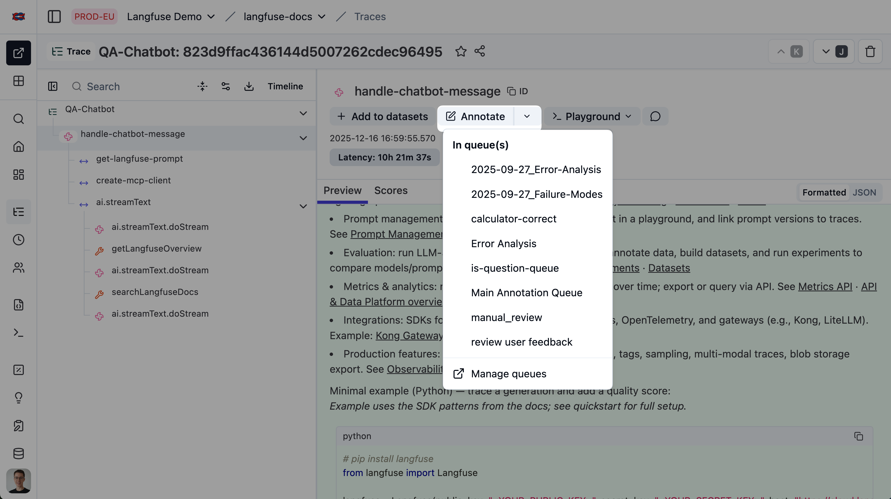
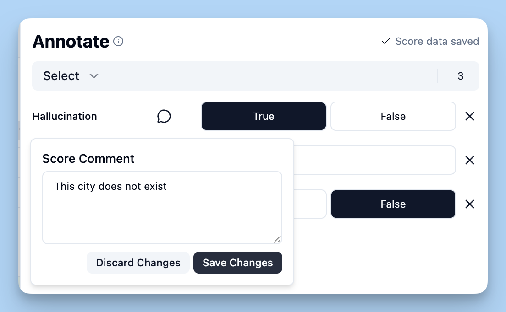

# A6 · 人工标注与业务复核

| 页面属性 | 内容 |
|---|---|
| 负责人 | @HXL |
| 状态 | 草稿 |
| 适用 Langfuse 版本 | Python SDK v4（本机 4.15.0）；自托管 4.46.0（沿用同日版本核对记录，标注与导出页面待实机验证） |
| 最后验证日期 | 2026-09-29（仓库、官方资料、图片和本地命令核对；沙箱流程待验证） |
| 验证人 |  |

## 1. 适用人群与使用场景

业务同事需要判断用例结果是否符合预期，开发和测试需要导出复核结论、整理成回归用例时，按本手册操作。

## 2. 前置条件

**账号权限**：已能进入指定沙箱并查看待复核记录；打分和界面导出通常需要 `Member`，`Viewer` 只能查看。依据见官方 [权限说明](https://langfuse.com/docs/administration/rbac)。

| 用途 | 需要的环境变量名称 |
|---|---|
| 打开网页 | `LANGFUSE_BASE_URL` 对应入口；只操作网页无需本机配置变量 |
| 开发核对远端评分配置 | `LANGFUSE_BASE_URL`、`LANGFUSE_PUBLIC_KEY`、`LANGFUSE_SECRET_KEY`，必须属于指定沙箱 |
| 本地检查 fixture | 无需 Langfuse 环境变量；需要仓库和已有 `.venv` Python 环境 |

## 3. 操作步骤

### 步骤 1：认清本次要处理的对象

1. 打开 `Evaluation → Human Annotation`，页面标题可能显示 `Annotation Queues`。
2. 找到 `业务人工复核`，核对队列说明和本次待办范围。

| 名称 | 通俗解释 |
|---|---|
| Annotation Queue | 待人工查看的一批记录，相当于待办清单 |
| Score Config | 评分表的定义：评什么、允许选什么 |
| Score | 某个人或评分程序对某条记录给出的结果 |
| Score Comment | 这次评分的理由，跟随这条 Score 保存 |
| fixture | 仓库里的回归用例文件，保存输入和经过确认的预期 |

本项目使用 `human_business_verdict` 记录用例级人工结论。名称、类型和可选值以 [评分定义](../../../scripts/langfuse/definitions/score-configs.json)为准，队列绑定以 [队列定义](../../../scripts/langfuse/definitions/annotation-queues.json)为准。不要在 Notion 另建一份评分规则表。

### 步骤 2：核对队列配置（维护人操作）

1. 查看队列绑定的 Score Config，确认包含 `human_business_verdict`。
2. 若缺少队列、缺少评分或绑定不符，把现象交维护人处理；标注人不要另建同名配置。
3. 维护人需要核对差异时，在仓库根目录运行：

```powershell
.\.venv\Scripts\python.exe -X utf8 scripts/langfuse/upload_score_configs.py --dry-run
```

**这个预览会连接 Langfuse。** 脚本读取仓库 `.env`，其中同名配置会覆盖当前进程的环境变量；仅在已确认该文件指向指定沙箱的独立工作副本中运行。不要以为只在 PowerShell 临时设置变量就切换了项目。配置未确认时，只查看帮助：

```powershell
.\.venv\Scripts\python.exe -X utf8 scripts/langfuse/upload_score_configs.py --help
```

4. 阅读 `Action`：`unchanged` 表示匹配；`would_create`、`would_update`、`would_replace` 表示拟创建、更新或替换；`drift` 表示队列绑定有差异。
5. 将差异交维护人按 [同步说明](../../../scripts/langfuse/README.md#upload_evaluatorspy--upload_score_configspy)处理，再回到页面核对。`--dry-run` 不会修复差异，退出码为零也不保证没有 `drift`。

该脚本同步评分配置与队列定义，不会分配审核人，也不会把实验结果自动加入队列。本章不执行 `--apply`。尚无可用队列时，先完成配置交接，再继续标注。

### 步骤 3：把正确的记录加入队列（整理人操作）

已在队列中的记录可直接进入步骤 4。

1. 按 [A5](./a5-experiment-comparison.md)打开要复核的 Experiment Item，核对运行名和用例编号。
2. 选择代表该用例完整结果的记录，保留它的 Trace ID 和 Observation ID。不要误选某次模型调用或单个 HTTP 轮次来代表整条多轮用例。
3. 展开 `Annotate` 菜单，选择 `业务人工复核`。
4. 返回队列，确认记录已加入，且仍对应同一运行和用例。缺少实验或预期的生产样本先作为待确认材料，不冒充已具备预期的实验用例。



图 1：Langfuse Demo 的文档问答测试，用于辨认入队入口；操作时选择本项目指定沙箱的队列。来源：[官方入队说明](https://langfuse.com/docs/evaluation/evaluation-methods/annotation-queues)及[原图](https://langfuse.com/images/docs/add_to_queue.png)。

批量整理时，可在记录列表勾选同批对象，再使用 `Actions → Add to queue`；已有版本也可能显示 `Add to Annotation Queue`。提交前核对条数和目标队列，无法确认对象范围时改用单条入队。

### 步骤 4：读证据，再填写结论（业务方操作）

1. 打开队列中的一条记录，先核对用例编号和运行名。
2. 对照 `Input`、该次运行使用的预期和实际 `Output`。多轮用例逐轮查看，必要时按 [A1](./a1-trace-troubleshooting.md)打开关联 Trace。
3. 查看已有确定性 Score、`Comment` 和字段差异，确认争议发生在哪一轮、哪个字段。程序给出通过或失败，都不能代替业务方确认预期本身是否正确。
4. 在 `Annotate` 找到 `human_business_verdict`，按已确认的业务依据选择结论。材料不全或存在争议时选 `待确认`，写清需要谁补充什么；不要猜答案。
5. 打开该评分的评论控件，在 `Score Comment` 填写理由，使用 `Save Changes` 保存。若页面采用自动保存，等待 `Score data saved`，再到详情的 `Scores` 确认值和评论均已保存。

可以按这个顺序写评论：**用例与轮次 → 期望 → 实际差异 → 依据 → 下一步**。例如，合成测试记录可写：

> 错误。测试用例第 2 轮明确要求查询，实际识别为撤单；依据为本轮测试输入和业务方确认的预期。交开发检查意图解析，保留原预期。



图 2：官方通用评分示例，用于辨认评论和保存操作；本项目选择 `human_business_verdict`。来源：[官方人工评分说明](https://langfuse.com/docs/evaluation/evaluation-methods/scores-via-ui)及[原图](https://langfuse.com/images/docs/scores_comment.png)。两张官方图片均未展示客户交易数据，不作为本项目实机验证证据。

`Score Comment` 与记录上的普通 `Add comment` 用途不同。本流程把评分理由写在 Score Comment，方便随评分一起导出。平台允许不填评论；为了让下一位同事复核，错误或待确认项应把依据写清楚。

### 步骤 5：保存修正建议，完成队列待办

1. 若已能给出正确结果，可用 `Correct output` 保存修正建议；当前页面没有该入口时，将建议写入 Score Comment，并交工程师整理。
2. 核对 Score 已保存，再点击 `Mark Completed` 或 `Complete + next`，进入下一条。
3. 对 `待确认` 项保留交接清单和负责补充的人。即使已完成本次标注，也继续保留业务待办；使用跳过操作的记录同样要列为未处理。
4. 处理完后，核对本批已标注、待确认、跳过和未处理数量，确保每个用例都有去向。

**完成队列待办只表示本次查看和记录结束。** 它不表示业务正确、修复完成或验收通过。`Correct output` 也不会自动更新 Dataset 或 Git，后续仍须复核合入，参见 [官方队列说明](https://langfuse.com/docs/evaluation/evaluation-methods/annotation-queues)。

### 步骤 6：导出人工评分与复核材料

1. 打开 `Evaluation → Scores` 的表格视图；如果有 `Scores / Analytics` 和 `Table / Chart`，选择 `Scores → Table`。
2. 用页面提供的搜索或筛选，限定名称为 `human_business_verdict`、来源为 `ANNOTATION`，并核对本次标注时间与环境。实验评分找不到时，检查是否包含 `sdk-experiment`。
3. 对照步骤 3 的对象 ID 清单，确认属于本批用例。同名评分和时间范围可能包含其他队列的记录，不能把搜索结果都算成本队列的产出。
4. 使用表格的导出入口，选择 JSON 或 CSV，下载到负责人指定的受控目录。若当前版本没有导出入口，或按钮不可用，交维护人核对权限和版本；由其使用只读 API 导出同一范围，不自行升级平台。
5. 打开导出文件，抽查刚才处理的一条记录：评分名、分类标签、Comment、关联 ID 与页面一致。按 Score ID 核对重复记录，再按用例核对覆盖；多人评分时，一条用例可以有多条 Score。
6. 单独补齐本批队列清单、已确认的输入与预期、原实际输出、修正建议及审阅记录。**Scores 导出不等于完整标注包**，不能假设其中包含队列状态、输入输出、`Correct output` 或 Git 用例编号。

导出会沿用表格筛选，但**隐藏列仍会导出**；截图隐藏字段也不会让源数据脱敏。下载后检查内容，脱敏后才可上传或分享。格式与范围见官方 [导出说明](https://langfuse.com/docs/api-and-data-platform/features/export-from-ui)。

交接时可附这份记录；它是核对清单，不是 Dataset 字段定义：

```text
沙箱项目 / 队列名称与 ID：
标注范围 / 导出时间及时区 / 筛选条件：
运行名 / 用例编号 / 数据与断言版本：
Trace ID / Observation ID / Score ID：
结论 / 依据 / 已确认的预期或修正建议：
待确认、跳过或遗漏项 / 补充人：
业务复核人 / 复核日期 / 工程接收人：
脱敏材料的存放位置 / 后续 Git 修改记录：
```

若导出中只显示数值，按关联 Score Config 找回分类标签，不把 `待确认` 的数值当成“通过一半”。同一用例出现不同结论时保留各自依据，交业务负责人裁定；不要取平均值生成最终答案。

### 步骤 7：复核后合入 fixture（业务方与工程师交接）

1. **业务方确认预期**：对错误、争议和缺少预期的样本逐条确认。系统实现错误时保留正确预期；只有原预期确有错误时才提出修订，并保留理由。仍待确认的样本留在候选材料中。
2. **工程师确定归属**：现役业务用例进入 `tests/datasets/biz/`，意图用例进入 `tests/datasets/intent/`；选择标准和字段格式查 [数据集说明](../../../tests/datasets/README.md)。节点样本另按 [ADR 0029 D2、D5](../../adr/0029-node-level-debug-api-and-regression-workbench.md)处理，不恢复已退役的节点 fixture 目录。
3. **在工作分支整理修改**：按稳定用例编号找到原记录，新样本使用不重复的编号。按既有格式保存完整输入、必要引用与历史、业务方确认的预期。JSONL 每行一个用例；导出的 Score 文件不能直接复制成 fixture，分类标签也不是业务期望字段。
4. **检查差异与文件一致性**：在仓库根目录执行：

```powershell
git diff -- tests/datasets/biz tests/datasets/intent
.\.venv\Scripts\python.exe -X utf8 scripts/check_fixture_consistency.py --verbose
```

5. **提交给审阅人**：提供修改文件、新增文件、用例编号、来源 ID、业务依据和检查结果。`git diff` 不显示尚未跟踪的新文件，需单独打开核对。关联材料放在受控目录，不把客户原文、评分导出包或凭据提交到仓库。
6. **核对合入与发布**：按团队流程审阅并合入 Git，再按 [A4 步骤 7](./a4-dataset-management.md#步骤-7核对一次已有发布的结果)核对发布记录、目标沙箱和新版本用例。本手册不触发面向正式项目的同步。
7. **安排对应回归**：由测试负责人按本次改动选择相关用例，使用已授权的环境；涉及真实业务写入时按项目授权安排。查看新实验的确定性评分和差异，保留原运行记录；放行标准仍见 [ADR 0030 D3](../../adr/0030-goal-restatement-native-langgraph-dataset-eval-harness.md#d3--统一评测门)。

文件检查通过只表示格式和一致性检查通过，不表示业务通过。完整流向是：**人工结论 → 业务复核 → Git fixture 审阅 → 单向发布 → 相关回归**，依据为 [ADR 0029 D5](../../adr/0029-node-level-debug-api-and-regression-workbench.md#d5--逐步迁移到-langfuse-回归闭环)。

## 4. 验证：做完后应该看到什么

- [ ] 正在操作指定沙箱，队列与评分名称匹配仓库定义。
- [ ] 每条已标注记录能对应到完整用例及运行；刷新后结论和 Score Comment 仍可查看。
- [ ] 能区分评分保存、队列完成、业务复核通过和回归通过。
- [ ] 导出文件与页面抽查一致，本批待确认、跳过、遗漏和多人分歧均有记录。
- [ ] 交接材料包含经过复核的预期及关联 ID，另一位同事可以找到原记录。
- [ ] 若已合入 fixture，能查到审阅记录、Git 修改和对应发布版本；尚未合入或回归的明确记为待处理。
- [ ] 未向手册或外部平台上传未脱敏数据；未改正式项目或升级依赖。

实际操作人完成沙箱流程后填写验证日期和姓名，由 @HXl 审阅决定发布状态。本次资料核对和本地命令检查不代表已完成平台标注、导出或业务验收。

## 5. 常见问题

| 问题 | 怎么处理 |
|---|---|
| 看得到记录，不能打分或导出 | 请管理员核对 Member 权限；队列分配本身不授予项目访问权 |
| 找不到队列或评分名称 | 核对沙箱、队列绑定及 Score Config 是否归档；交维护人处理，不随手新建同名项 |
| 预览显示 drift，但退出码是零 | 仍有绑定差异；保存 Action 结果交维护人，不按退出码认定配置一致 |
| 自动评分与人工结论不同 | 核对是否评同一用例、同一范围和同版预期；记录分歧，由业务方确认预期，工程师检查评分实现 |
| 输入、预期或输出不完整 | 选待确认并写明缺口；没有依据不能当正确，也不把缺少执行结果当模型答错 |
| 点了分类，但评论没有保留 | 检查评论是否单独保存，再打开 Scores 确认；不要只看分类是否高亮 |
| 标注完成，分数却不在实验汇总中 | 核对是否标在错误的 Trace、子 Observation 或 Session，以及所用筛选；不要为了补汇总重复交易 |
| 导出数量与队列数量不同 | 分别检查多人评分、旧评分、未标注项、时间与环境筛选，并按关联 ID 对账；评分行数不是用例数 |
| Correct output 已填，Dataset 没变 | 属于正常情况；它是修正建议，仍需业务复核、Git 审阅和单向发布 |
| 想拿标注后的 1 当自动评分 PASS | 人工分类和确定性断言是不同记录；不能用人工分覆盖自动验收结果 |

## 6. 本项目不用的功能及原因

| 功能或做法 | 原因与替代操作 |
|---|---|
| LLM-as-a-Judge 裁定批量验收或代填标准答案 | 按 ADR 0005 使用确定性断言，业务方确认争议预期 |
| 从标注直接自动覆盖 biz / intent 基线 | 按 ADR 0029 先导出复核、合入 Git，再单向发布，避免两套预期 |
| 把完成队列或 Correct output 当作自动发布 | 二者都不是发布审批；继续执行审阅与相关回归 |
| 为补齐证据自动回放下单、确认或撤单节点 | 写节点只留存标注，自动节点回放须跳过；边界见 ADR 0029 |
| 用生产记录公开分享、直接制作教学截图 | Trace 含客户原文和交易参数；使用测试数据或先脱敏 |
| 在 Notion 维护评分规则、数据字段表或生产提示词副本 | 仓库和 ADR 是规则真源；Notion 只写操作并链接过去 |

## 7. 参考

| 用途 | 仓库文件与 ADR |
|---|---|
| 人工评分与队列定义 | [score-configs.json](../../../scripts/langfuse/definitions/score-configs.json)、[annotation-queues.json](../../../scripts/langfuse/definitions/annotation-queues.json) |
| 配置同步与环境读取 | [upload_score_configs.py](../../../scripts/langfuse/upload_score_configs.py)、[_public_api.py](../../../scripts/langfuse/_public_api.py) |
| 已有页面说明 | [WebUI 手册 §3.9](../web-ui-operation-manual.md#39-人工打分)、[功能指南 §4.3](../workflow-guide.md#43-配置人工评分口径) |
| 业务方与工程师分工、评分原则 | [ADR 0005](../../adr/0005-annotation-roles-judge-plus-business-spotcheck.md) |
| 标注回流、fixture 与回放限制 | [ADR 0029](../../adr/0029-node-level-debug-api-and-regression-workbench.md)、[数据集说明](../../../tests/datasets/README.md) |
| 单向发布与验收 | [auto-sync.md](../auto-sync.md)、[ADR 0030](../../adr/0030-goal-restatement-native-langgraph-dataset-eval-harness.md) |
| 提示词真源 | [ADR 0023](../../adr/0023-prompt-as-code-langgraph.md) |
| 资料差异与待验证事项 | [资料审阅记录](../../reports/2026-09-29-langfuse-manual-source-review.md)；发现问题交 @HXl 审阅，不在手册另立口径 |

Langfuse 官方文档：[Annotation Queues](https://langfuse.com/docs/evaluation/evaluation-methods/annotation-queues)、[Scores via UI](https://langfuse.com/docs/evaluation/evaluation-methods/scores-via-ui)、[Scores Data Model](https://langfuse.com/docs/evaluation/scores/data-model)、[Export from UI](https://langfuse.com/docs/api-and-data-platform/features/export-from-ui)、[Access Control](https://langfuse.com/docs/administration/rbac)。
