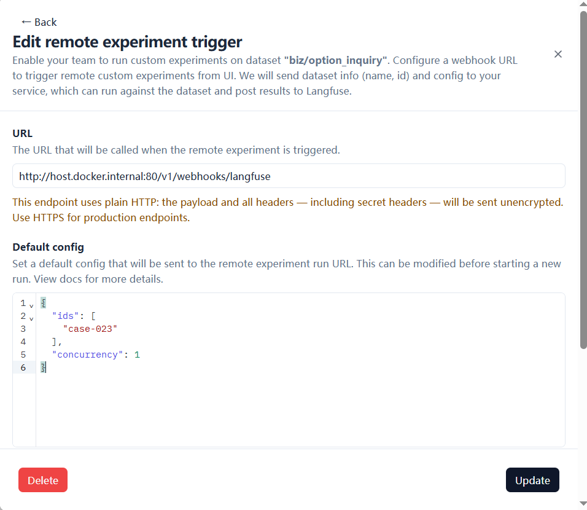
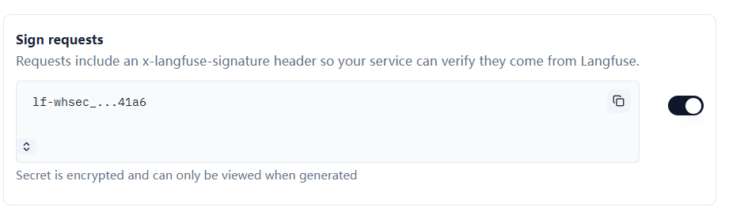

# Remote Experiment Webhook 对接

在 Langfuse Dataset 页面点 `Run`，直接触发本机跑一次数据集实验，结果按 Dataset / Experiment / Score
闭环回写。端点实现见 [app/api/langfuse_webhook.py](../../app/api/langfuse_webhook.py)。

本机侧只做验签、解析配置、点火；实验交给 `scripts/langfuse/langfuse_eval.py` 子进程跑。

## 一、Langfuse 侧

Dataset → `Start Experiment` → `⚡ Custom Experiment` → 填 URL 与 Default config：



- **URL** —— `http://host.docker.internal:80/v1/webhooks/langfuse`
  - 端口只能是 **80 或 443**：Langfuse 发送前做 SSRF 校验，其它端口直接拒绝，白名单放不开
  - Langfuse 跑在容器里时用 `host.docker.internal`；容器内的 `localhost` 指容器自己
- **Default config** —— 默认参数，触发时用户可改，支持的键见 § 三
- **Advanced Options → Enabled** —— 暂停触发但保留配置

打开 **Sign requests**，保存后密钥只显示一次：



把它复制到根目录 `.env` 的 `LANGFUSE_WEBHOOK_SECRET`。密钥丢了就关掉开关保存、再打开保存，会重新生成。

## 二、本机侧

```bash
uvicorn app.main:app --port 80        # 必须是 80 或 443
```

| 变量 | 文件 | 说明 |
|---|---|---|
| `ENABLE_LANGFUSE_WEBHOOK` | `.env` | 默认 `false`；关闭时端点返回 404 |
| `LANGFUSE_WEBHOOK_SECRET` | `.env` | Langfuse 生成的一次性密钥；为空返回 503 |
| `LANGFUSE_WEBHOOK_WHITELISTED_HOST` | `infra/langfuse/.env` | 填 `host.docker.internal`，改后需 `docker compose up -d` |

白名单那项是必需的：`host.docker.internal` 解析到私网地址，Langfuse 默认拒绝。

## 三、Default config 支持的参数

| 键 | 类型 | 默认 | 说明 |
|---|---|---|---|
| `ids` | 字符串数组 | 全部 | 只跑指定用例，填 golden case id（如 `case-023`），也接受 dataset item 的 UUID |
| `limit` | 正整数 | 不限 | 只跑前 N 条 |
| `concurrency` | 正整数 | `1` | 并发数；业务集保持 1，并发高会撞后端 dedup |

```json
{ "ids": ["case-023"], "concurrency": 1 }
```

- **`dataset` 也不用配**：用 Langfuse 传来的 `datasetName`，UI 上选的哪个就是哪个
- 其余未知键直接返回 400 —— 拼写错误当场暴露，不静默忽略
- 评分固定 `--no-judge`（[ADR 0005](../adr/0005-annotation-roles-judge-plus-business-spotcheck.md)：批量评分只用确定性断言）

## 四、响应与排查

| 状态码 | 含义 |
|---|---|
| `202` | 已受理，实验在子进程里跑 |
| `401` | 签名校验失败：密钥不一致，或 Langfuse 侧没打开 Sign requests |
| `404` | `ENABLE_LANGFUSE_WEBHOOK` 未打开 |
| `409` | 同一 dataset 已有实验在跑 |
| `503` | 开关已开但密钥为空 |

实验输出写在 `.harness-runs/langfuse-webhook-*.log`。
